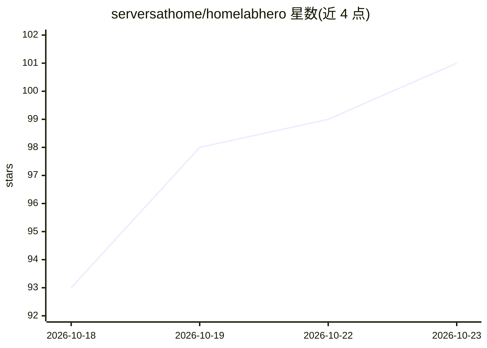

# serversathome/homelabhero

⭐ 101 · Shell · 推送 2026-10-14 · [GitHub](https://github.com/serversathome/homelabhero) · 组织维护

**把 LXC 装成 AI 家庭实验室控制中心：装 Claude Code 并代理凭据**

面向自建家庭实验室（homelab）的一键安装工具：在全新 Ubuntu LXC 上以一条命令安装 Claude Code、claudecodeui Web 界面（端口 3001）以及预置技能。核心机制是凭据代理：Claude 以 hhagent 用户运行，无法读取 vault 中的凭据，通过 hh run 与单一 sudoers 规则经 SSH 操作 TrueNAS/Proxmox/Linux/MikroTik，另提供 UniFi/Firewalla/NetBird/Cloudflare 四个网络集成（部分只读）。仅支持 Ubuntu/Debian（依赖 apt/systemd/visudo）。

## 筛选速览

| 维度 | 判定 | 备注 |
|---|---|---|
| AI 角色 | `ai-ecosystem` | LLM/agent 周边工具 |
| 许可风险 | `none` | — |
| 部署形态 | `None` |  |
| 模型依赖 | locked-api |  |
| 硬件要求 | — | 无带数字的原话,不猜 |
| 安装摩擦 | `low` | 无编译、无系统依赖或容器化 |
| 成熟度 | — | 结构信号不足 |

## 能力要点

- 一条命令安装 Claude Code + Web UI + 预置技能
- 凭据隔离 vault：agent 无读取权限，凭据不接触 LLM
- hh run 统一命令经 SSH 操作 TrueNAS/Proxmox/Linux/MikroTik
- UniFi/Firewalla（只读）与 NetBird/Cloudflare（可写）四个网络集成

## 适用场景

- 把家里的服务器、虚拟机统一交给 Claude 管理
- 让 AI 运维主机而不暴露 SSH 凭据
- 集中查看所有主机上运行的 VM、容器与应用

## 场景标签

 · 领域:自托管运维/自动化

## 证据(README 行号)

> L26: Turn a fresh LXC into an AI homelab command center. One command installs Claude
> L36: - Credentials never touch the LLM, and cannot: they live in a vault the agent

## 星数曲线

2026-10-18 93 → 2026-10-23 101（+8）

---
*卡片 v1 · prompt 1.4 · 生成 2026-10-23 · 置信度 high · 依据 README sha `c757af8ece22` · [字段定义](../../DATASET.md)*
