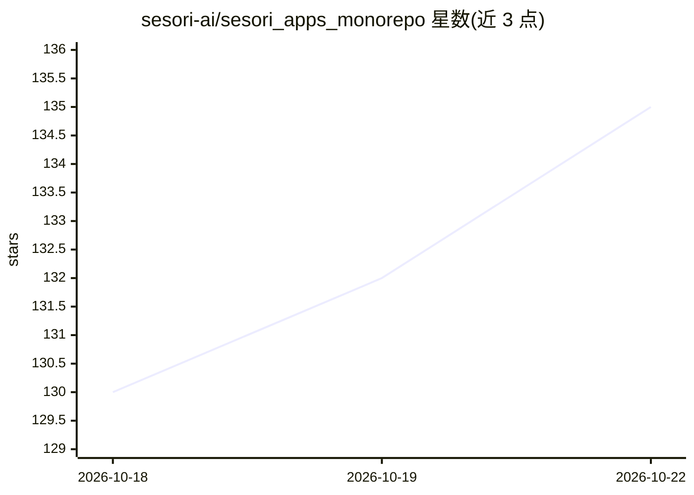

# sesori-ai/sesori_apps_monorepo

⭐ 135 · Dart · NOASSERTION · 推送 2026-10-19 · [GitHub](https://github.com/sesori-ai/sesori_apps_monorepo) · [官网](https://sesori.com) · 组织维护

**手机远程驾驶本机 AI 编程 agent 的移动客户端+Bridge CLI**

由 Sesori 团队提供的 Flutter 移动应用与源码可用的 Bridge CLI：Bridge 运行在开发机上，通过 WebSocket 中继与手机配对，全程 X25519 密钥交换 + XChaCha20-Poly1305 端到端加密，中继只见不透明二进制帧。支持 OpenCode、Codex CLI、Copilot CLI、Antigravity、Cursor、Claude Code、Pi/OMP、DeepSeek Harness、Grok Build 等 10 种编程 agent 集成（ACP/native 协议），用户在手机上浏览会话、审批步骤、看 diff 与 PR 状态、语音或文字交互并接收通知。凭据保留在本机，不发送至手机。Bridge 采用 FSL-1.1-ALv2 许可。

## 筛选速览

| 维度 | 判定 | 备注 |
|---|---|---|
| AI 角色 | `ai-ecosystem` | LLM/agent 周边工具 |
| 许可风险 | `none` | NOASSERTION |
| 部署形态 | `library` | 以包/库形式分发 |
| 模型依赖 | locked-api |  |
| 硬件要求 | — | 无带数字的原话,不猜 |
| 安装摩擦 | `low` | 无编译、无系统依赖或容器化 |
| 成熟度 | — | 结构信号不足 |

## 能力要点

- 10 种 AI 编程助手集成（ACP/native JSONL/stream-json 等协议），可同一 Bridge 并行多助手
- 端到端加密：X25519 临时密钥交换 + XChaCha20-Poly1305，中继只路由密文帧
- 手机端可审批步骤、查看 diff 与 PR 状态、语音/文字交互、实时通知
- 源码可用的 Bridge CLI，许可为 FSL-1.1-ALv2

## 适用场景

- 离开工位后用手机继续跟进本机上的 AI 编程会话
- 远程审批 agent 的操作步骤并接收完成通知
- 在手机上查看代码 diff 与 PR 状态

## 场景标签

 · 领域:开发者工具/AI 编程

## 证据(README 行号)

> L7:  Sesori is the mobile cockpit for your AI coding sessions — OpenCode, OpenAI Codex CLI, GitHub Copilot CLI, Google A
> L54: The Bridge is a small source-available command-line tool that connects the app to your AI coding assistants — the f

## 星数曲线

2026-10-18 130 → 2026-10-22 135（+5）

---
*卡片 v1 · prompt 1.4 · 生成 2026-10-22 · 置信度 high · 依据 README sha `14b391759aac` · [字段定义](../../DATASET.md)*
