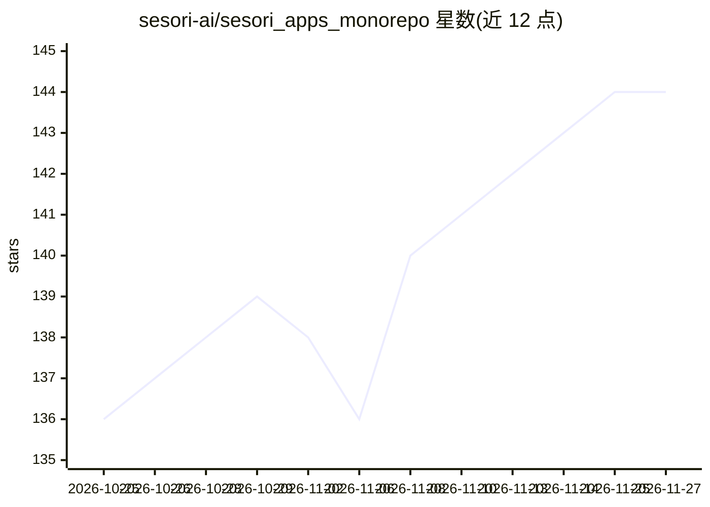

# sesori-ai/sesori_apps_monorepo

⭐ 144 · Dart · NOASSERTION · 推送 2026-11-26 · [GitHub](https://github.com/sesori-ai/sesori_apps_monorepo) · [官网](https://sesori.com) · 组织维护

**在手机上远程监控与操控本地 AI 编码代理的应用**

Sesori 由两部分组成：手机端应用（iOS/Android）与运行在本机的 Bridge CLI。Bridge 与本机各编码代理（OpenCode、Codex CLI、Copilot CLI、Antigravity、Cursor、Claude Code、Hermes、Pi、Oh My Pi、DeepSeek Harness、Grok Build）通过各自协议或 ACP 集成，经 WebSocket 连接中继服务器，手机可浏览项目与会话、回复代理提问、批准步骤、查看 diff、接收任务完成通知。传输采用 X25519 密钥交换与 XChaCha20-Poly1305 端到端加密，中继只转发不透明帧。Bridge 与客户端协议源码可得，许可证为 FSL-1.1-ALv2。

## 筛选速览

| 维度 | 判定 | 备注 |
|---|---|---|
| AI 角色 | `ai-ecosystem` | LLM/agent 周边工具 |
| 许可风险 | `none` | NOASSERTION |
| 部署形态 | `library` | 以包/库形式分发 |
| 模型依赖 | locked-api |  |
| 硬件要求 | — | 无带数字的原话,不猜 |
| 安装摩擦 | `low` | 无编译、无系统依赖或容器化 |
| 成熟度 | — | 结构信号不足 |

## 能力要点

- 手机端浏览项目、回复提问、批准步骤、停止/重启任务、查看代码 diff
- 支持 11 个编码代理，默认全部启用，同一 Bridge 可并行多个会话
- X25519 + XChaCha20-Poly1305 端到端加密，中继仅路由不透明二进制帧
- Bridge 为 source-available（FSL-1.1-ALv2），本机代码可审计

## 适用场景

- 离开电脑后继续跟进长时间运行的编码代理任务
- 在手机上批准或中断代理的执行步骤
- 随时收到代理需要人工介入的实时通知

## 场景标签

`编码 Agent` · 领域:编码与开发

## 证据(README 行号)

> L5:  Run your AI coding agents from your phone.
> L93: A lightweight Bridge runs on your laptop alongside your AI coding assistant. It connects to a relay server over Web
> L118: |Assistant|Integration|

## 星数曲线

2026-10-25 136 → 2026-11-27 144（+8）

---
*卡片 v1 · prompt 1.4 · 生成 2026-11-27 · 置信度 high · 依据 README sha `4edafff71323` · [字段定义](../../DATASET.md)*
