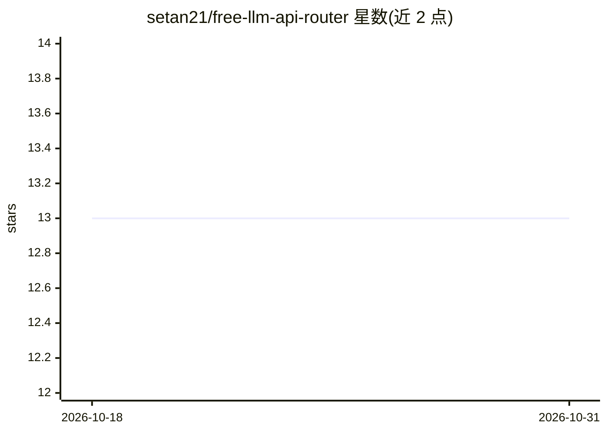

# setan21/free-llm-api-router

⭐ 13 · Python · 推送 2026-06-25 · [GitHub](https://github.com/setan21/free-llm-api-router) · 个人维护

**免费 LLM 提供商的 OpenAI 兼容路由器，带自动故障转移**

基于 FastAPI 的自托管 API 路由服务：将 OpenAI 兼容格式请求分发到 8 个免费 LLM 提供商（Mistral、Google AI Studio、Groq、Cerebras、SambaNova、Together、Fireworks、Chutes），支持自动故障转移、轮询负载均衡、429 限流检测自动轮换、插件式添加自定义提供商及使用量统计。兼容任意 OpenAI SDK 直连替换，内置仪表盘查看提供商状态、延迟与故障转移事件。需自行注册各提供商的免费 API key，通过 git clone 源码部署。

## 筛选速览

| 维度 | 判定 | 备注 |
|---|---|---|
| AI 角色 | `ai-ecosystem` | LLM/agent 周边工具 |
| 许可风险 | `none` | — |
| 部署形态 | `None` |  |
| 模型依赖 | locked-api |  |
| 硬件要求 | — | 无带数字的原话,不猜 |
| 安装摩擦 | `low` | 无编译、无系统依赖或容器化 |
| 成熟度 | — | 结构信号不足 |

## 能力要点

- 8 个免费提供商间自动故障转移与轮询负载均衡
- OpenAI 兼容格式，可作为任意 OpenAI SDK 的替换端点
- 插件架构支持添加自定义提供商
- 内置仪表盘：提供商状态、请求计数、延迟统计、故障转移事件

## 适用场景

- 我在用免费 LLM API 时想要自动切换不可用或限流的提供商
- 统一多个免费提供商为一个 OpenAI 兼容端点
- 查看各免费提供商的用量与延迟情况

## 场景标签

`模型网关` · 领域:Agent 开发

## 证据(README 行号)

> L3: **Route your requests across multiple free LLM providers with automatic failover.**
> L10: - 🎯 **OpenAI-compatible** — drop-in replacement for any OpenAI SDK

## 星数曲线

2026-10-18 13 → 2026-10-31 13（+0）

---
*卡片 v1 · prompt 1.4 · 生成 2026-10-31 · 置信度 high · 依据 README sha `01f2f3252e2e` · [字段定义](../../DATASET.md)*
