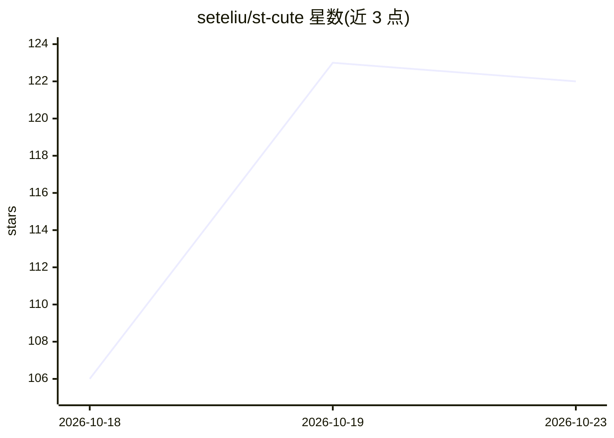

# seteliu/st-cute

⭐ 122 · Java · MIT · 推送 2026-10-08 · [GitHub](https://github.com/seteliu/st-cute) · 个人维护 · 中文 README

**桌面与网页端的 AI Coding Agent，支持移动端访问**

基于 Java 25 / Spring Boot / Vue 3 / Tauri 2 的 AI 编程代理（Coding Agent）与 Harness，提供桌面、网页（响应式、移动端可用）及无 UI 服务器三种部署形态，Releases 页面提供 base / bundle / desktop 三类预编译包，desktop 与 bundle 包内置 JRE。功能包含 ReAct Loop、SubAgent、工具调用、SKILL / MCP / HOOK / RULE、路径沙箱、权限管控与多粒审批；模型接入支持 OpenAI Chat、OpenAI Response、Anthropic Claude 三种协议，可自定义供应商与完整 URL；内置工具读取 PDF / Word / Excel / PPT。引擎侧为零 Spring 依赖的自研 Java ReAct 框架，可独立集成于 SaaS。base 包需自备 Java 25+ 环境。

## 筛选速览

| 维度 | 判定 | 备注 |
|---|---|---|
| AI 角色 | `ai-native` | 本体是模型或模型工具 |
| 许可风险 | `permissive` | MIT |
| 部署形态 | `desktop` | 安装包/桌面程序 |
| 模型依赖 | — | README 未给出锁定关系 |
| 硬件要求 | — | 无带数字的原话,不猜 |
| 安装摩擦 | `high` | 编译与系统依赖俱全 |
| 成熟度 | — | 结构信号不足 |

## 能力要点

- ReAct Loop + SubAgent + 工具调用矩阵的 Coding Agent
- SKILL / MCP / HOOK / RULE 与极简 Skill 按需触发模式
- 支持 OpenAI Chat / OpenAI Response / Anthropic Claude 三种协议与自定义供应商
- base / bundle / desktop 三类预编译包，桌面壳由 Rust + Tauri 2 构建

## 适用场景

- 在桌面、网页或手机上通过 AI 进行编程辅助（Vibe Coding）
- 部署到无 UI 服务器供多终端访问的 AI 编程代理
- 通过 MCP / SKILL / HOOK 扩展智能体能力

## 场景标签

`编码 Agent` · 领域:编码与开发

## 证据(README 行号)

> L7: **ST-Cute** 是一个简约好用、功能齐全、同时提供桌面端与网页端的 AI Coding Agent & Harness。
> L44: |**后端** (`st-cute-core`)|Java 25 / Spring Boot 4.1|ReAct 引擎 + 本地 CodingAgent 宿主|

## 星数曲线

2026-10-18 106 → 2026-10-23 122（+16）

---
*卡片 v1 · prompt 1.4 · 生成 2026-10-23 · 置信度 mid · 依据 README sha `3d2eb4287730` · [字段定义](../../DATASET.md)*
