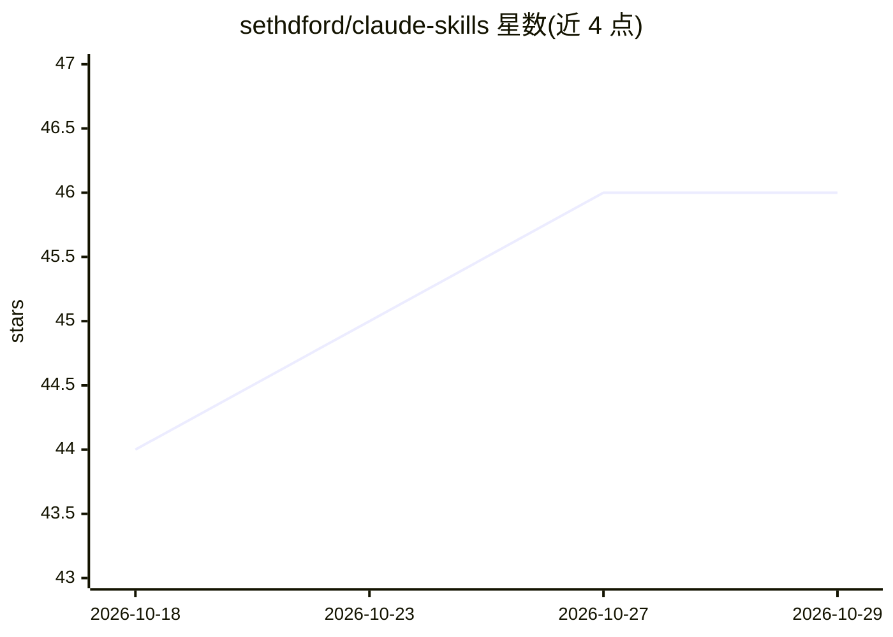

# sethdford/claude-skills

⭐ 46 · MIT · 推送 2026-03-11 · [GitHub](https://github.com/sethdford/claude-skills) · 个人维护

**面向 PDLC 全角色的 Claude Code 技能合集（454 技能/8 角色）**

为 Claude Code 提供的技能与命令合集：覆盖架构师、工程师、产品经理、技术负责人、安全、设计师、QA 工程师等 8 个产品开发生命周期角色，共 454 个技能、173 条命令、57 个插件。每个角色对齐行业知识体系（SWEBOK、TOGAF、OWASP、ISTQB、NIST、AIPMM 等），每个技能包含针对 LLM 失效模式（幻觉、过度泛化等）的反模式章节，并产出具体交付物（文档、图表、决策记录、测试计划）。通过 claude install 命令按角色、插件或整体安装。

## 筛选速览

| 维度 | 判定 | 备注 |
|---|---|---|
| AI 角色 | `ai-knowledge` | 知识聚合/清单类 |
| 许可风险 | `permissive` | MIT |
| 部署形态 | `None` |  |
| 模型依赖 | — | README 未给出锁定关系 |
| 硬件要求 | — | 无带数字的原话,不猜 |
| 安装摩擦 | `low` | 无编译、无系统依赖或容器化 |
| 成熟度 | — | 结构信号不足 |

## 能力要点

- 8 个 PDLC 角色共 454 技能、173 命令、57 插件
- 每个角色对齐行业标准（SWEBOK/TOGAF/OWASP/ISTQB/NIST 等）
- 每个技能含 LLM 错误缓解反模式章节
- 技能产出具体交付物（ADR、威胁模型、测试计划等）

## 适用场景

- 为 Claude Code 配备各开发角色的领域知识与工作流
- 按角色或插件选择性安装所需能力
- 产出架构决策记录、威胁模型、PRD 等具体交付物

## 场景标签

`提示工程` · 领域:Agent 开发

## 证据(README 行号)

> L3: Comprehensive, standards-grounded Claude Code skills for every role in the Product Development Lifecycle.
> L5: **454 skills** and **173 commands** across **57 plugins** for **8 roles**.
> L33: claude install github:sethdford/claude-skills/engineer

## 星数曲线

2026-10-18 44 → 2026-10-29 46（+2）

---
*卡片 v1 · prompt 1.4 · 生成 2026-10-25 · 置信度 high · 依据 README sha `7b5c81dd5552` · [字段定义](../../DATASET.md)*
