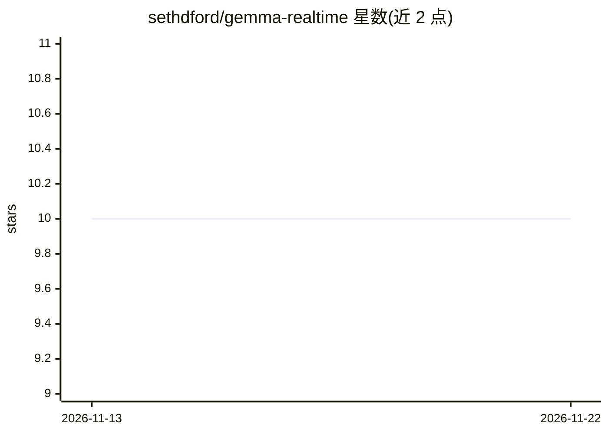

# sethdford/gemma-realtime

⭐ 10 · Python · MIT · 推送 2026-10-31 · [GitHub](https://github.com/sethdford/gemma-realtime) · [官网](https://sethdford.github.io/gemma-realtime) · 个人维护

**在 Apple Silicon 上本地微调 Gemma 4 并实时推理的流水线**

面向 Apple Silicon 用户的完整流水线：从 iMessage、Facebook Messenger 等平台提取个人对话，用 LoRA 在本地微调 Gemma 4，再经 MLX/Ollama/llama.cpp 等多种后端以实时语音速度（实测 111 tok/s）本地推理，全程无云、无需 API key。附基准测试方法、KV 缓存压缩（TurboQuant+）配置、Apple 隐藏硬件 API 基准与各型号最低/推荐内存要求。

## 筛选速览

| 维度 | 判定 | 备注 |
|---|---|---|
| AI 角色 | `ai-ecosystem` | LLM/agent 周边工具 |
| 许可风险 | `permissive` | MIT |
| 部署形态 | `library` | 以包/库形式分发 |
| 模型依赖 | local-ok | 支持本地模型 |
| 硬件要求 | — | 无带数字的原话,不猜 |
| 安装摩擦 | `low` | 无编译、无系统依赖或容器化 |
| 成熟度 | — | 结构信号不足 |

## 能力要点

- LoRA 微调 + 多后端本地推理完整流水线（MLX/Ollama/llama.cpp/vLLM Metal/ANE+GPU）
- TurboQuant+ KV 缓存压缩 3.8-6.4x，--realtime 标志自动启用
- 对 AMX/SME2、ANE、IOSurface 等 Apple 未公开硬件 API 的基准测试
- 全程本地运行，数据不离机

## 适用场景

- 用自己的聊天记录微调一个模仿个人语言风格的 Gemma 模型
- 在 Mac 上搭建满足语音延迟目标的本地实时对话服务
- 按型号选择合适的后端与量化配置做推理优化

## 场景标签

`语音 Agent` `微调` `推理引擎` `模型量化` · 领域:对话与助手

## 证据(README 行号)

> L19: Fine-tune Google's Gemma 4 on your own conversations (iMessage, Facebook Messenger, etc.) and serve it at **real-ti
> L47: **gemma-realtime** gives you the complete pipeline:
> L50: 2. **Fine-tune** Gemma 4 with LoRA in minutes on Apple Silicon
> L51: 3. **Serve** at real-time speeds through your choice of optimized backend

## 星数曲线

2026-11-13 10 → 2026-11-22 10（+0）

---
*卡片 v1 · prompt 1.4 · 生成 2026-11-19 · 置信度 high · 依据 README sha `e43c174c71c2` · [字段定义](../../DATASET.md)*
