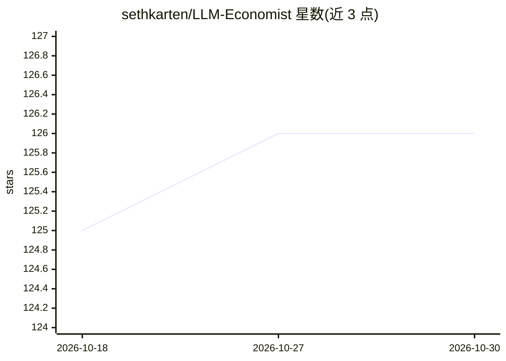

# sethkarten/LLM-Economist

⭐ 126 · Python · MIT · 推送 2026-03-11 · [GitHub](https://github.com/sethkarten/LLM-Economist) · 组织维护

**科研框架：用 LLM 驱动多智能体经济模拟研究税收机制设计**

2025 年论文 LLM Economist 的官方代码库。框架将经济系统建模为 Stackelberg 博弈：Tax Planner 设定税收政策最大化社会福利，Worker 智能体依据政策优化劳动分配。支持 3-1000+ 个智能体，提供 rational/bounded/democratic 三种场景，基于人口统计数据用 LLM 生成智能体人设。模型接入覆盖 OpenAI、Gemini、OpenRouter 及本地 vLLM/Ollama；以 Python 包（pip 安装）与实验脚本形式提供，MIT 许可，配套论文复现流程与 W&B 实验跟踪。

## 筛选速览

| 维度 | 判定 | 备注 |
|---|---|---|
| AI 角色 | `ai-native` | 本体是模型或模型工具 |
| 许可风险 | `permissive` | MIT |
| 部署形态 | `library` | 以包/库形式分发 |
| 模型依赖 | local-ok | 支持本地模型 |
| 硬件要求 | — | 无带数字的原话,不猜 |
| 安装摩擦 | `low` | 无编译、无系统依赖或容器化 |
| 成熟度 | — | 结构信号不足 |

## 能力要点

- 两层级多智能体强化学习建模：税收规划者（Leader）与工人（Follower）的 Stackelberg 博弈
- 支持 3-1000+ 智能体并行模拟，三种经济场景（理性/有限理性/民主投票）
- 基于真实人口普查数据（职业/年龄/性别）由 LLM 生成智能体人设
- 多 LLM 接入：OpenAI/Gemini/OpenRouter 云端 API 与 vLLM/Ollama 本地部署

## 适用场景

- 复现论文中的税收政策优化实验
- 研究机制设计下 LLM 智能体群体的经济行为
- 通过自定义 Worker 效用函数或新增 LLM 提供商扩展实验

## 场景标签

`多智能体` `科研工具` `强化学习` · 领域:Agent 开发

## 证据(README 行号)

> L10: A comprehensive framework for economic simulations using Large Language Models (LLMs). The LLM Economist leverages 
> L24: The LLM Economist framework models economic systems as a two-level multi-agent reinforcement learning problem, impl
> L432:   title={LLM Economist: Large Population Models and Mechanism Design in Multi-Agent Generative Simulacra},

## 星数曲线

2026-10-18 125 → 2026-10-30 126（+1）

---
*卡片 v1 · prompt 1.4 · 生成 2026-10-23 · 置信度 high · 依据 README sha `428cbc0ede18` · [字段定义](../../DATASET.md)*
