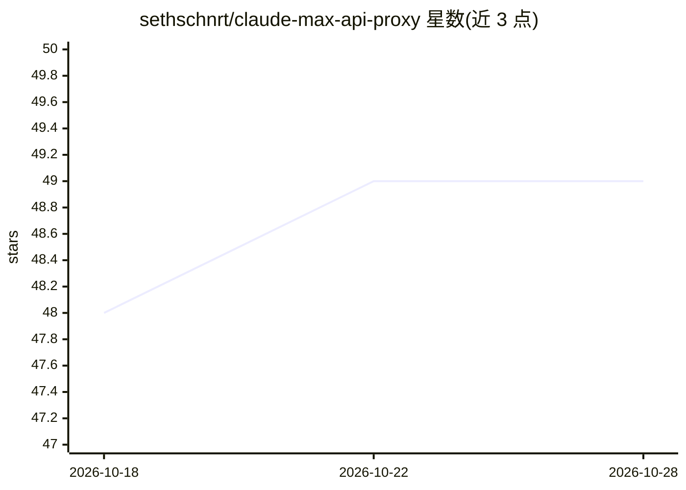

# sethschnrt/claude-max-api-proxy

⭐ 49 · TypeScript · MIT · 推送 2026-02-14 · [GitHub](https://github.com/sethschnrt/claude-max-api-proxy) · [官网](https://sethschnrt.github.io/claude-max-api-proxy/) · 个人维护

**把 Claude Max 订阅包装成 OpenAI 兼容 API 的本地代理**

面向已订阅 Claude Max（$200/月）的用户：通过调用本机已认证的 Claude Code CLI 子进程（claude --print），在本地暴露 OpenAI 兼容的 /v1/chat/completions 等端点，使 Continue.dev、Cursor、自定义应用等 OpenAI 客户端直接使用订阅额度而非按 token 计费的 API key。支持流式 SSE、多模型映射（Opus/Sonnet/Haiku）、用量统计、可选 Bearer 认证与 macOS LaunchAgent 常驻。README 提示需自行审阅 Anthropic 服务条款，风险自担。

## 筛选速览

| 维度 | 判定 | 备注 |
|---|---|---|
| AI 角色 | `ai-ecosystem` | LLM/agent 周边工具 |
| 许可风险 | `permissive` | MIT |
| 部署形态 | `library` | 以包/库形式分发 |
| 模型依赖 | — | README 未给出锁定关系 |
| 硬件要求 | — | 无带数字的原话,不猜 |
| 安装摩擦 | `low` | 无编译、无系统依赖或容器化 |
| 成熟度 | — | 结构信号不足 |

## 能力要点

- 包装 Claude Code CLI 子进程，暴露 OpenAI 兼容 API（含流式 SSE）
- Opus/Sonnet/Haiku 多模型映射及 provider 前缀 ID
- token 用量统计与节省金额展示（/v1/usage）
- 可选 API key 认证与 macOS LaunchAgent 自启动

## 适用场景

- 让 Cursor/Continue.dev 等工具用我的 Max 订阅而非按 token 付费
- 团队共享场景下为代理加 Bearer 认证
- 查看代理的 token 用量与请求记录

## 场景标签

`模型网关` · 领域:Agent 开发

## 证据(README 行号)

> L5: Your Claude Max subscription includes unlimited* Claude usage through the CLI. This proxy wraps that CLI and exposes
> L40: Your App (any OpenAI client)
> L50: - **OpenAI-compatible API** — Drop-in replacement for any OpenAI client

## 星数曲线

2026-10-18 48 → 2026-10-28 49（+1）

---
*卡片 v1 · prompt 1.4 · 生成 2026-10-24 · 置信度 high · 依据 README sha `30774bed0c17` · [字段定义](../../DATASET.md)*
