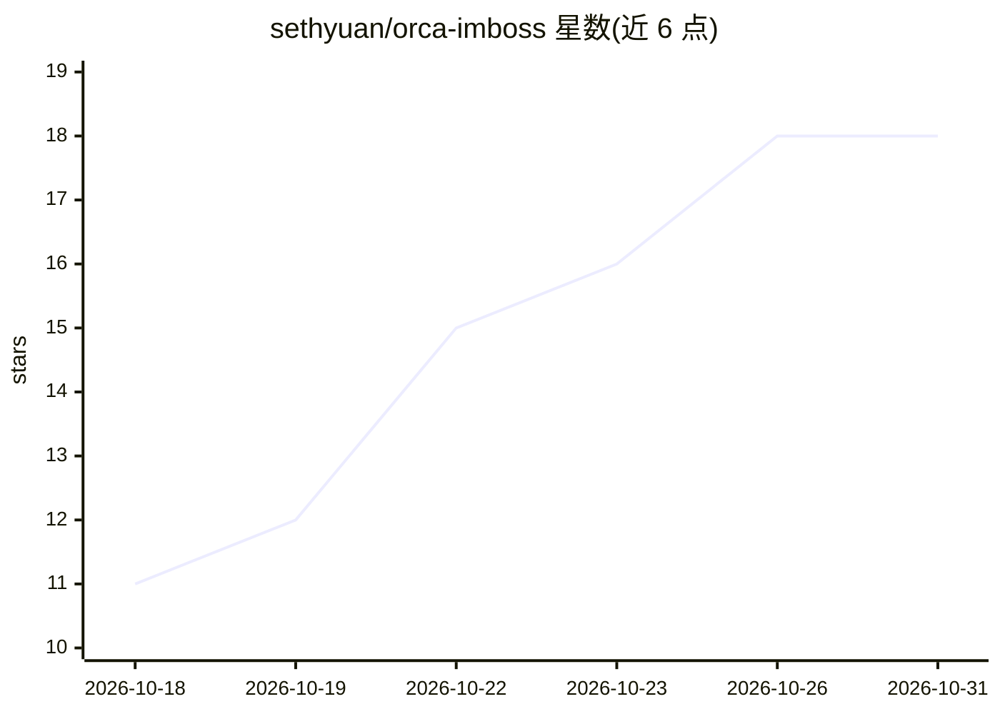

# sethyuan/orca-imboss

⭐ 18 · TypeScript · GPL-3.0 · 推送 2026-10-30 · [GitHub](https://github.com/sethyuan/orca-imboss) · [官网](https://orca-studio.com/imboss/) · 个人维护 · 中文 README

**单人公司 AI 团队桌面应用：聊天指挥 AI 员工协作完成工作**

Electron 桌面应用，用户与内置 Assistant（编排者）对话，Assistant 拆解任务、招募带角色/人设/模型/技能/MCP 服务器的 AI 员工，在任务群聊中分工协作并交付成果。支持 OpenAI 兼容、Anthropic、Google 等多家模型供应商，可接入 WeChat/QQ/Telegram 消息桥接、定时任务与本地 Mini Apps。数据全部本地存放于 ~/.imboss，支持远程后端模式（Node.js + gRPC）。构建需 Node.js >= 22、pnpm 及原生模块编译工具链。

## 筛选速览

| 维度 | 判定 | 备注 |
|---|---|---|
| AI 角色 | `ai-native` | 本体是模型或模型工具 |
| 许可风险 | `dual` | GPL-3.0 |
| 部署形态 | `library` | 以包/库形式分发 |
| 模型依赖 | locked-api |  |
| 硬件要求 | — | 无带数字的原话,不猜 |
| 安装摩擦 | `medium` | 含编译或系统依赖之一 |
| 成熟度 | — | 结构信号不足 |

## 能力要点

- Assistant 自动拆解任务、招募并调度 AI 员工在群聊协作
- 每个员工可独立配置模型、思考等级、技能与 MCP 服务器
- WeChat/QQ/Telegram 消息桥接与 cron 定时任务
- 远程模式：后端以 Node.js 包运行，桌面端经 gRPC 连接

## 适用场景

- 用对话让 AI 团队完成研究、写作、执行命令等交付物
- 通过手机上的微信/QQ/Telegram 远程指挥 AI 团队
- 在服务器上运行后端、本地桌面连接的部署方式

## 场景标签

`多智能体` `聊天机器人` · 领域:Agent 开发

## 证据(README 行号)

> L7: imboss is a desktop app where you chat with an AI **Assistant** who acts as your chief of staff. Tell it what you ne
> L19: 3. **Employees do the work.** Each employee has its own role, persona, model, tools, skills and MCP servers. They r
> L52: - Connect providers through a curated list (Anthropic, OpenAI, DeepSeek, Google, Groq, MiniMax, Moonshot AI, OpenRo

## 星数曲线

2026-10-18 11 → 2026-10-31 18（+7）

---
*卡片 v1 · prompt 1.4 · 生成 2026-10-29 · 置信度 high · 依据 README sha `c6b466087b7a` · [字段定义](../../DATASET.md)*
