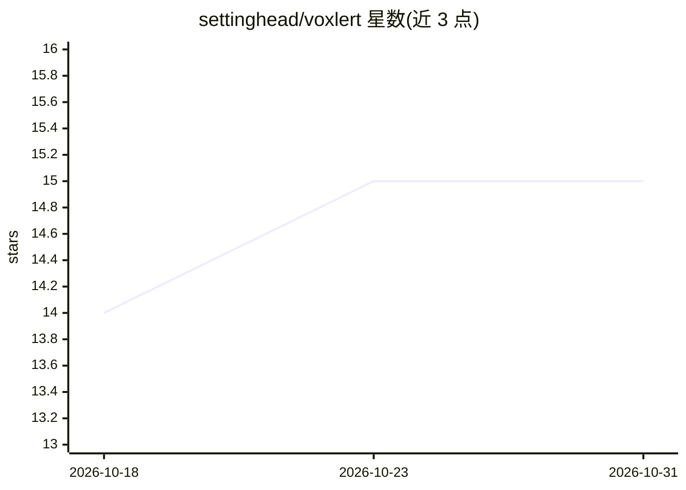

# settinghead/voxlert

⭐ 15 · JavaScript · MIT · 推送 2026-10-16 · [GitHub](https://github.com/settinghead/voxlert) · [官网](https://www.npmjs.com/package/@settinghead/voiceforge) · 个人维护

**为多路 AI 编码 agent 会话提供游戏角色语音通知的 CLI 工具**

面向并发运行 Claude Code、Cursor、Codex、pi、OpenClaw 等编码 agent 的开发者：通过 hook/notify 事件触发，将任务完成、工具失败、等待审批等事件映射为事件类别，由 LLM 按所选游戏角色（星际争霸 Adjutant/Kerrigan、SHODAN、HEV Suit 等 9 个语音包）生成短句，再经本地 TTS 后端（Qwen3-TTS/Chatterbox，需 GPU 或 Apple Silicon）合成播放，也可退化为纯文本通知与预置短语。LLM 可接 OpenRouter/OpenAI/Gemini/Anthropic 或本地 OpenAI 兼容服务器实现全离线，npx 一键安装。限制：TTS 后端需 Python 与 GPU；单词组词生成需 API key（可用 fallback 短语跳过）。

## 筛选速览

| 维度 | 判定 | 备注 |
|---|---|---|
| AI 角色 | `ai-enhanced` | 去掉 AI 部分产品仍成立 |
| 许可风险 | `permissive` | MIT |
| 部署形态 | `library` | 以包/库形式分发 |
| 模型依赖 | local-ok | 支持本地模型 |
| 硬件要求 | — | 无带数字的原话,不猜 |
| 安装摩擦 | `medium` | 含编译或系统依赖之一 |
| 成熟度 | — | 结构信号不足 |

## 能力要点

- Claude Code/Cursor/Codex/pi/OpenClaw 五类 agent 的 hook 事件集成
- LLM 按游戏角色生成事件播报短语，9 个官方语音包
- 支持 Ollama/LM Studio/llama.cpp 本地 LLM 与 Qwen3-TTS 本地 TTS 的全离线模式
- 无 LLM API key 时可用语音包预置 fallback 短语与文本通知

## 适用场景

- 同时跑多个 AI 编码会话时靠声音分辨哪个 agent 在等我
- 不想盯屏幕，用角色语音获得编码 agent 的环境音反馈
- 在离线机器上为零成本语音通知搭建本地 LLM + TTS 流程

## 场景标签

`语音合成` · 领域:内容生成

## 证据(README 行号)

> L221: 1. A hook or notify event fires from Claude Code, Cursor, Codex, pi, or OpenClaw.
> L223: 3. Contextual events such as task completion or tool failure can use the configured LLM to generate a short in-cha
> L230: The LLM step (turning events into in-character phrases) uses a small, cheap model — not Claude. Each notification 

## 星数曲线

2026-10-18 14 → 2026-10-31 15（+1）

---
*卡片 v1 · prompt 1.4 · 生成 2026-10-30 · 置信度 high · 依据 README sha `1e345abbc6ef` · [字段定义](../../DATASET.md)*
