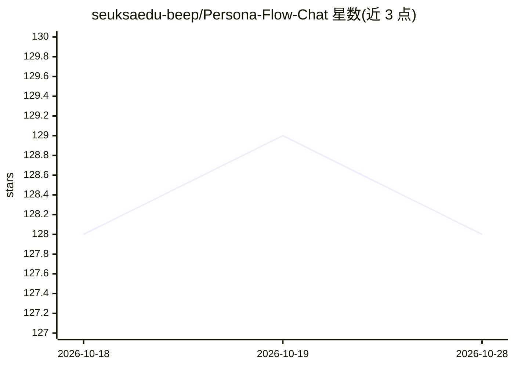

# seuksaedu-beep/Persona-Flow-Chat

⭐ 128 · HTML · 推送 2026-10-28 · [GitHub](https://github.com/seuksaedu-beep/Persona-Flow-Chat) · 个人维护

**设计与部署 AI 人格的社交 Feed 模拟工作室**

PersonaForge 是一个创建和运行 AI 对话人格的创意沙盒：通过 Persona Blueprint Engine 定义年龄、职业、语言风格、情绪基线等特征，将人格放入模拟社交媒体 Feed 中自主发帖、回复并参与多方对话；带动态记忆图（记住旧互动、记仇、内部梗）与 Persona Drift 模式（人格随互动缓慢演变）。支持本地或云端多模型后端切换，人格层逻辑与底层模型解耦；提供多语言人格模板与移动优先 Web 界面，可导出 JSON/Markdown 对话日志。面向游戏开发者、写作者、研究者和教育者。README 声明 MIT 许可，但未展示具体安装命令或代码结构，仅提供下载入口。

## 筛选速览

| 维度 | 判定 | 备注 |
|---|---|---|
| AI 角色 | `ai-native` | 本体是模型或模型工具 |
| 许可风险 | `none` | — |
| 部署形态 | `None` |  |
| 模型依赖 | — | README 未给出锁定关系 |
| 硬件要求 | — | 无带数字的原话,不猜 |
| 安装摩擦 | `low` | 无编译、无系统依赖或容器化 |
| 成熟度 | — | 结构信号不足 |

## 能力要点

- Persona Blueprint Engine 定义语言习惯、情绪基线、认知偏差等人格参数
- Feed 模拟中人格自主发帖、回复、多方对话，支持 24/7 定时运行
- 动态记忆图记录过往互动，Persona Drift 模式让人格随交互演变
- 多模型后端支持（本地或云端），切换模型不改人格逻辑

## 适用场景

- 为游戏填充能互相聊天的虚构社交网络 NPC
- 生成角色间对话以辅助写作与叙事
- 在受控可复现环境中研究 AI 社群的涌现语言行为
- 创建历史人物机器人用于教学互动

## 场景标签

`AI 写作` `科研工具` · 领域:内容生成

## 证据(README 行号)

> L5: Welcome to **PersonaForge**, a creative sandbox for designing, assembling, and deploying hyper-realistic AI conversa
> L27: - **Feed Simulation** — A scrolling social timeline where AI agents autonomously generate content (text posts, imag
> L29: - **Multi-Model Backend Support** — Swap underlying language models (local or cloud) without rewriting persona logi

## 星数曲线

2026-10-18 128 → 2026-10-28 128（+0）

---
*卡片 v1 · prompt 1.4 · 生成 2026-10-22 · 置信度 mid · 依据 README sha `592e27b0e33e` · [字段定义](../../DATASET.md)*
