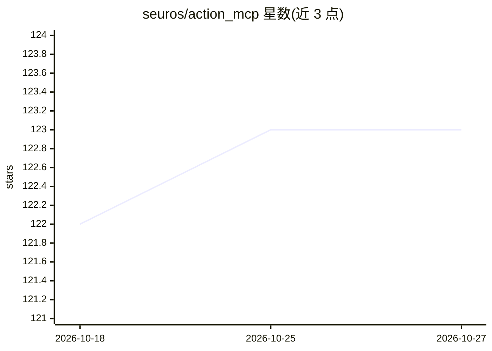

# seuros/action_mcp

⭐ 123 · Ruby · MIT · 推送 2026-10-23 · [GitHub](https://github.com/seuros/action_mcp) · 个人维护

**为 Rails 应用提供 MCP 服务器能力的 Ruby gem**

面向 Rails 开发者的 Ruby gem，将 Ruby on Rails 应用接入 Model Context Protocol（MCP），主要作为服务器端：提供 Prompt、Tool、ResourceTemplate 三个基类抽象，处理 MCP 2025-11-25 协议的 JSON-RPC 2.0 传输、能力协商、会话管理、Tasks 异步执行、敏感操作的用户同意（consent）流程与结构化输出。内置 Streamable HTTP 端点，明确不支持 STDIO 传输，面向生产网络部署。客户端功能仅支持连接远程 MCP 服务器。要求 Ruby 3.4.8+/Rails 8.1.1+ 及 PostgreSQL、MySQL 或 SQLite3 数据库。

## 筛选速览

| 维度 | 判定 | 备注 |
|---|---|---|
| AI 角色 | `ai-ecosystem` | LLM/agent 周边工具 |
| 许可风险 | `permissive` | MIT |
| 部署形态 | `library` | 以包/库形式分发 |
| 模型依赖 | — | README 未给出锁定关系 |
| 硬件要求 | — | 无带数字的原话,不猜 |
| 安装摩擦 | `low` | 无编译、无系统依赖或容器化 |
| 成熟度 | — | 结构信号不足 |

## 能力要点

- 实现 MCP 2025-11-25 协议：JSON-RPC 2.0、能力协商、有状态会话、错误码处理
- Prompt / Tool / ResourceTemplate 三类基类抽象，含参数校验与多种内容类型返回
- 敏感工具的 consent 管理流程（JSON-RPC -32002，会话级授权可撤销）
- MCP Tasks 异步执行：进度上报、tasks/get / tasks/result / tasks/cancel 轮询

## 适用场景

- 把 Rails 应用的功能以 MCP 工具/资源形式暴露给 LLM 客户端
- 为 AI 助手提供带用户授权确认的敏感操作接口
- 在 Rails 应用中托管生产级、网络化的 MCP 服务器端点
- 从 Rails 客户端连接远程 MCP 服务器

## 场景标签

 · 领域:LLM 基础设施/MCP 协议框架

## 证据(README 行号)

> L3: **ActionMCP** is a Ruby gem focused on providing Model Context Protocol (MCP) capability to Ruby on Rails applicatio
> L23: **ActionMCP** is targeted at developers building MCP-enabled Rails applications. It simplifies the process of integ
> L48: Instead of implementing MCP support from scratch, you can subclass and configure the provided **Prompt**, **Tool**,

## 星数曲线

2026-10-18 122 → 2026-10-27 123（+1）

---
*卡片 v1 · prompt 1.4 · 生成 2026-10-23 · 置信度 mid · 依据 README sha `128a547b1f03` · [字段定义](../../DATASET.md)*
