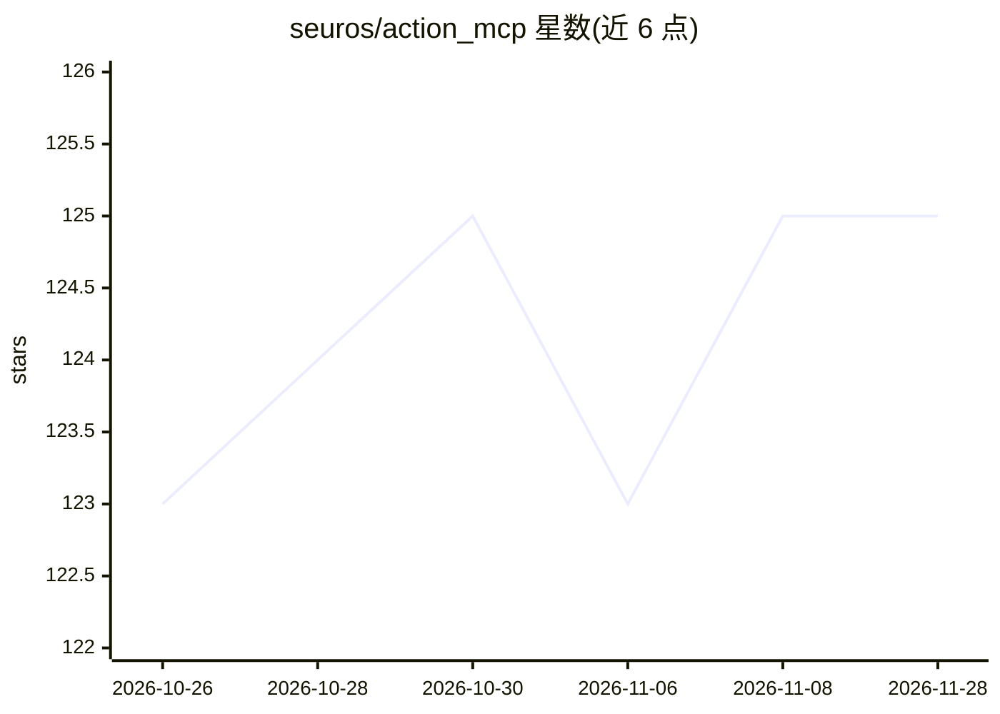

# seuros/action_mcp

⭐ 125 · Ruby · MIT · 推送 2026-11-23 · [GitHub](https://github.com/seuros/action_mcp) · 个人维护

**给 Rails 应用提供 MCP 服务器能力的 Ruby gem**

ActionMCP 是一个 Ruby gem，以 Rails Engine 形式为 Rails 应用提供 Model Context Protocol 服务端能力，面向生产环境的网络部署，明确不支持 STDIO 传输。它提供 Prompt、Tool、ResourceTemplate 等基类，处理 JSON-RPC 2.0 传输、能力协商、会话管理、敏感操作的用户同意流程、异步任务与进度上报等协议细节。要求 Ruby 3.4.8+/Rails 8.1.1+，数据库支持 PostgreSQL、MySQL 或 SQLite3。客户端功能仅用于连接远程 MCP 服务器，不支持本地进程。

## 筛选速览

| 维度 | 判定 | 备注 |
|---|---|---|
| AI 角色 | `ai-ecosystem` | LLM/agent 周边工具 |
| 许可风险 | `permissive` | MIT |
| 部署形态 | `library` | 以包/库形式分发 |
| 模型依赖 | — | README 未给出锁定关系 |
| 硬件要求 | — | 无带数字的原话,不猜 |
| 安装摩擦 | `low` | 无编译、无系统依赖或容器化 |
| 成熟度 | — | 结构信号不足 |

## 能力要点

- 实现 MCP 2025-11-25 协议：JSON-RPC 2.0 传输、能力协商、有状态会话管理
- 通过继承 Prompt/Tool/ResourceTemplate 基类暴露应用能力给 LLM
- 敏感工具的会话级用户同意管理（错误码 -32002）
- MCP Tasks 异步执行，支持进度上报、轮询与取消

## 适用场景

- 让 Rails 应用的功能通过 MCP 协议暴露给 AI 助手调用
- 为需要用户同意的敏感工具调用实现授权流程
- 需要异步执行并汇报进度的长时间工具任务

## 场景标签

 · 领域:LLM 基础设施/MCP 协议

## 证据(README 行号)

> L3: **ActionMCP** is a Ruby gem focused on providing Model Context Protocol (MCP) capability to Ruby on Rails applicatio
> L23: **ActionMCP** is targeted at developers building MCP-enabled Rails applications. It simplifies the process of integ
> L48: Instead of implementing MCP support from scratch, you can subclass and configure the provided **Prompt**, **Tool**,

## 星数曲线

2026-10-26 123 → 2026-11-28 125（+2）

---
*卡片 v1 · prompt 1.4 · 生成 2026-11-28 · 置信度 mid · 依据 README sha `b31160c5a272` · [字段定义](../../DATASET.md)*
