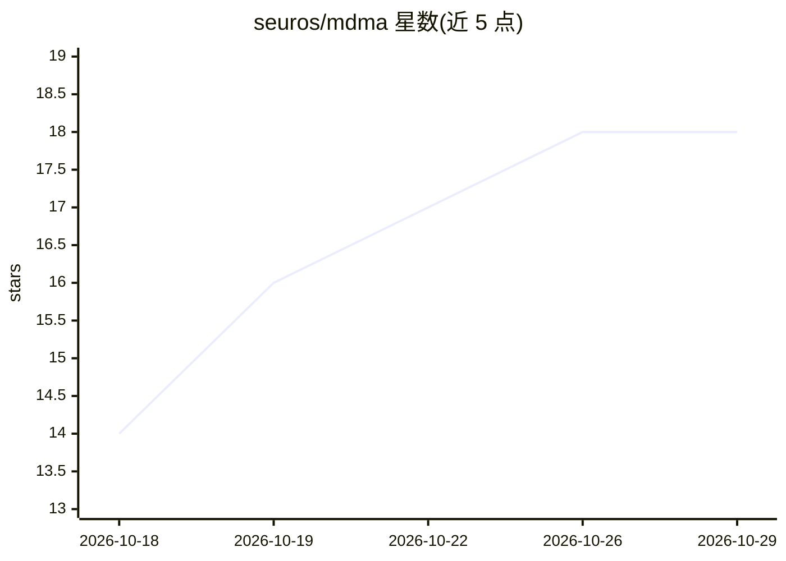

# seuros/mdma

⭐ — · [GitHub]() · 个人维护

**Rust 编写的多后端 LLM 推理引擎与私有联邦服务**

面向自有硬件的推理引擎：GGUF 加载、tokenizer、KV cache、采样器与自研计算内核收敛于一个 Backend trait，提供 CPU、ROCm、Vulkan、Level Zero、CUDA（仅驱动 API）、Metal 与 Coral Edge TPU 七种后端。内存侧在分配前预留权重/KV/workspace，放不下的请求以 RESOURCE_EXHAUSTED 拒绝。可作为 Rust crate 嵌入，或启用 mTLS 强制的 gRPC 服务与节点间私有联邦（显式注册、签名目录、默认关闭）。以 cargo 从源码构建，声明为实验性状态，各后端仅在少数设备上验证过。

## 筛选速览

| 维度 | 判定 | 备注 |
|---|---|---|
| AI 角色 | `ai-ecosystem` | LLM/agent 周边工具 |
| 许可风险 | `permissive` | — |
| 部署形态 | `None` |  |
| 模型依赖 | — | README 未给出锁定关系 |
| 硬件要求 | — | 无带数字的原话,不猜 |
| 安装摩擦 | `high` | 编译与系统依赖俱全 |
| 成熟度 | `idea` | |

## 能力要点

- 七种后端（CPU/ROCm/Vulkan/Level Zero/CUDA/Metal/Coral Edge TPU），内核自研非厂商库封装
- 精确内存准入：预留式分配，超出即拒绝而非事后崩溃；统一内存只计一次
- mTLS 强制的 gRPC 服务与无中心调度、无云的节点联邦协议
- GPU 内核全部对照 CPU 后端测试，checkpoint 门槛对齐 llama.cpp 参考输出

## 适用场景

- 让手头的桌面机、笔记本、Mac、小型服务器各自跑推理并组成私有服务网络
- 嵌入 Rust 应用获得可恢复的推理会话与显式内存控制
- 在 AMD/Intel/NVIDIA/Apple/Coral 等异构硬件上运行 GGUF 模型

## 场景标签

`推理引擎` · 领域:训练与推理

## 证据(README 行号)

> L7: mdma is an inference engine: GGUF loader,
> L9: kernels behind one `Backend` trait. Embed it as a Rust crate, or enable the

## 星数曲线

2026-10-18 14 → 2026-10-29 18（+4）

---
*卡片 v1 · prompt 1.4 · 生成 2026-10-29 · 置信度 high · 依据 README sha `3c026a45c7cb` · [字段定义](../../DATASET.md)*
