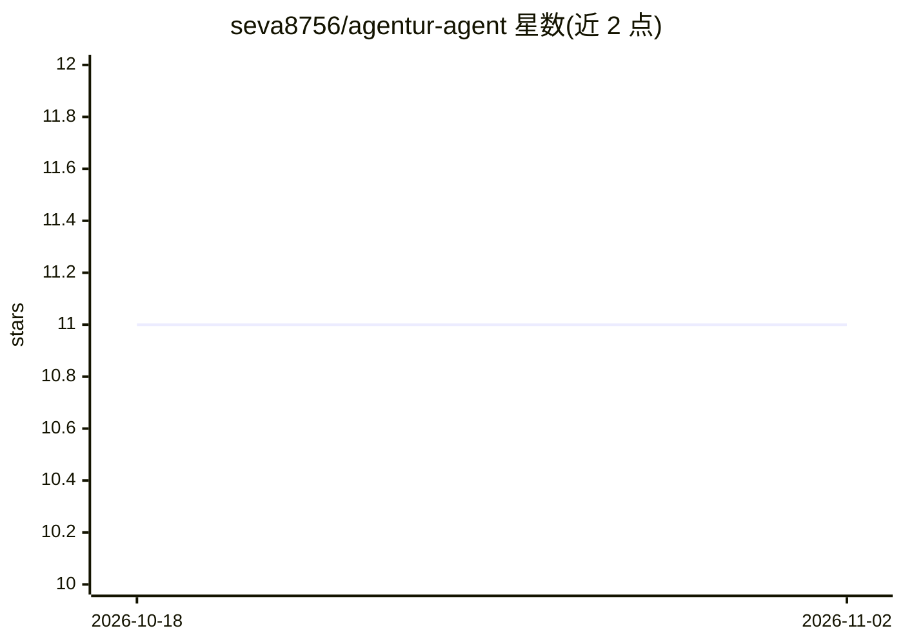

# seva8756/agentur-agent

⭐ 11 · TypeScript · MIT · 推送 2026-09-16 · [GitHub](https://github.com/seva8756/agentur-agent) · 个人维护 · 中文 README

**自托管多聊天 AI agent：每个聊天独立记忆与技能**

部署在用户服务器上的聊天 AI agent，通过适配器接入消息平台（当前实现 Telegram）。每个聊天拥有独立的记忆、事实/决策存储、人设（identity）、心情估计、文件系统与计划任务。用户自选 Chat Completions 兼容的 LLM 提供商（OpenAI/OpenRouter 等），数据存于普通文件，无需独立数据库。技能以 QuickJS 沙箱运行，支持远程 MCP 服务器接入。项目自述为 MVP、开发中。

## 筛选速览

| 维度 | 判定 | 备注 |
|---|---|---|
| AI 角色 | `ai-native` | 本体是模型或模型工具 |
| 许可风险 | `permissive` | MIT |
| 部署形态 | `self-host` | docker 或自建部署 |
| 模型依赖 | — | README 未给出锁定关系 |
| 硬件要求 | — | 无带数字的原话,不猜 |
| 安装摩擦 | `low` | 无编译、无系统依赖或容器化 |
| 成熟度 | `idea` | |

## 能力要点

- 每聊天独立的记忆、事实/决策、人设与设置
- 技能以 QuickJS 沙箱运行，可调用允许的 HTTP API 与远程 MCP 服务器
- 定时任务可发文本、请求模型或运行技能
- 数据以普通文件存储，无需单独数据库

## 适用场景

- 在 Telegram 群组或私聊中部署带长期记忆的 AI 助手
- 为工作群与朋友群设置不同人设的同一个 bot
- 让 agent 创建购物清单等自定义技能并定时运行

## 场景标签

`AI 助手` `聊天机器人` · 领域:对话与助手

## 证据(README 行号)

> L5: Agentur'a is an AI agent for chats, with memory, skills, mood, a chat file system, and scheduled tasks. It runs on y
> L7: Each chat has its own memory, settings, and integrations. You choose the LLM provider, and the agent stores its data

## 星数曲线

2026-10-18 11 → 2026-11-02 11（+0）

---
*卡片 v1 · prompt 1.4 · 生成 2026-11-01 · 置信度 high · 依据 README sha `3b160bdc5460` · [字段定义](../../DATASET.md)*
