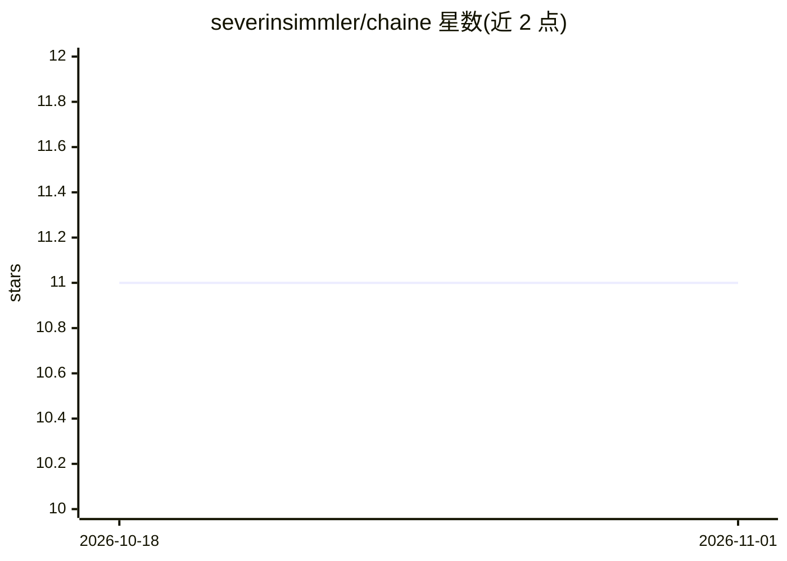

# severinsimmler/chaine

⭐ 11 · C · MIT · 推送 2026-10-08 · [GitHub](https://github.com/severinsimmler/chaine) · [官网](https://severinsimmler.github.io/chaine) · 个人维护

**线性链条件随机场 Python 库：用于 NLP 序列标注**

Chaine 是实现线性链条件随机场（CRF）的 Python 库，面向 NLP 序列标注任务如命名实体识别与词性标注。性能关键部分以 C 编写，提供 Linux/macOS/Windows 的 wheel 包，无需编译器，且无外部依赖；模型序列化不使用 pickle/joblib。训练算法含 L-BFGS、OWL-QN、SGD、平均感知机、PA、AROW 六种，并提供基于交叉验证的 HyperparameterOptimizer 超参搜索，以及批量/单序列预测、概率输出与权重导出 JSON 功能。

## 筛选速览

| 维度 | 判定 | 备注 |
|---|---|---|
| AI 角色 | `ai-native` | 本体是模型或模型工具 |
| 许可风险 | `permissive` | MIT |
| 部署形态 | `library` | 以包/库形式分发 |
| 模型依赖 | — | README 未给出锁定关系 |
| 硬件要求 | — | 无带数字的原话,不猜 |
| 安装摩擦 | `low` | 无编译、无系统依赖或容器化 |
| 成熟度 | — | 结构信号不足 |

## 能力要点

- 实现线性链 CRF，支持 6 种训练算法
- C 编写性能关键部分，三平台 wheel 无需编译
- HyperparameterOptimizer 做交叉验证超参搜索
- 可输出概率分布并将状态/转移权重导出为 JSON

## 适用场景

- 训练 CRF 模型做命名实体识别或词性标注
- 查看模型学到的特征权重做分析
- 自动搜索训练超参数

## 场景标签

 · 领域:自然语言处理/机器学习

## 证据(README 行号)

> L7: Chaine is a modern, fast and lightweight Python library implementing **linear-chain conditional random fields**. Use
> L29: - Limited-Memory BFGS (Nocedal 1980)

## 星数曲线

2026-10-18 11 → 2026-11-01 11（+0）

---
*卡片 v1 · prompt 1.4 · 生成 2026-11-01 · 置信度 high · 依据 README sha `31346e59c395` · [字段定义](../../DATASET.md)*
