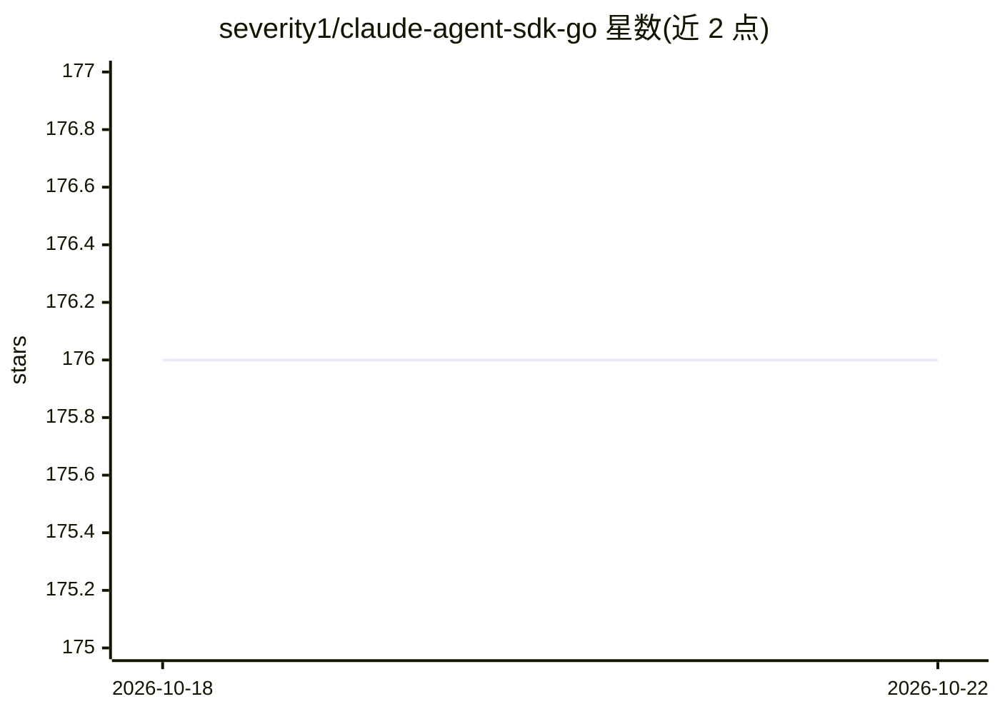

# severity1/claude-agent-sdk-go

⭐ 176 · Go · MIT · 推送 2026-10-05 · [GitHub](https://github.com/severity1/claude-agent-sdk-go) · 个人维护

**Claude Code CLI 的非官方 Go SDK，封装查询与多轮会话**

面向 Go 开发者的 Claude Code CLI 非官方 SDK，提供 Query API（一次性任务、自动化、CI/CD）与 Client API（多轮会话、流式响应），WithClient 提供自动资源管理。支持会话隔离、工具权限控制、MCP 外部服务集成、生命周期钩子、文件检查点、进程内 MCP 服务器等能力，功能与官方 Python SDK 对齐。前置要求为 Go 1.18+、Node.js 与全局安装的 Claude Code CLI，MIT 许可。

## 筛选速览

| 维度 | 判定 | 备注 |
|---|---|---|
| AI 角色 | `ai-ecosystem` | LLM/agent 周边工具 |
| 许可风险 | `permissive` | MIT |
| 部署形态 | `library` | 以包/库形式分发 |
| 模型依赖 | — | README 未给出锁定关系 |
| 硬件要求 | — | 无带数字的原话,不猜 |
| 安装摩擦 | `low` | 无编译、无系统依赖或容器化 |
| 成熟度 | — | 结构信号不足 |

## 能力要点

- Query/Client 双 API 覆盖自动化与交互式场景
- 会话隔离、权限回调、生命周期钩子、文件检查点等生产特性
- 支持内置文件工具与 MCP 外部服务集成
- 14 个分级示例工程覆盖从入门到生产模式

## 适用场景

- 在 Go 服务中调用 Claude Code 完成代码分析或自动化任务
- 构建基于 Claude 的多轮交互工作流与 CI/CD 集成
- 通过 MCP 接入 AWS、数据库等外部工具

## 场景标签

 · 领域:LLM 基础设施/开发者工具

## 证据(README 行号)

> L11: Unofficial Go SDK for Claude Code CLI integration. Build production-ready applications that leverage Claude's advan
> L14: - **Query API**: One-shot operations, automation, CI/CD integration
> L15: - **Client API**: Interactive conversations, multi-turn workflows, streaming responses

## 星数曲线

2026-10-18 176 → 2026-10-22 176（+0）

---
*卡片 v1 · prompt 1.4 · 生成 2026-10-22 · 置信度 mid · 依据 README sha `ea64fc605af8` · [字段定义](../../DATASET.md)*
