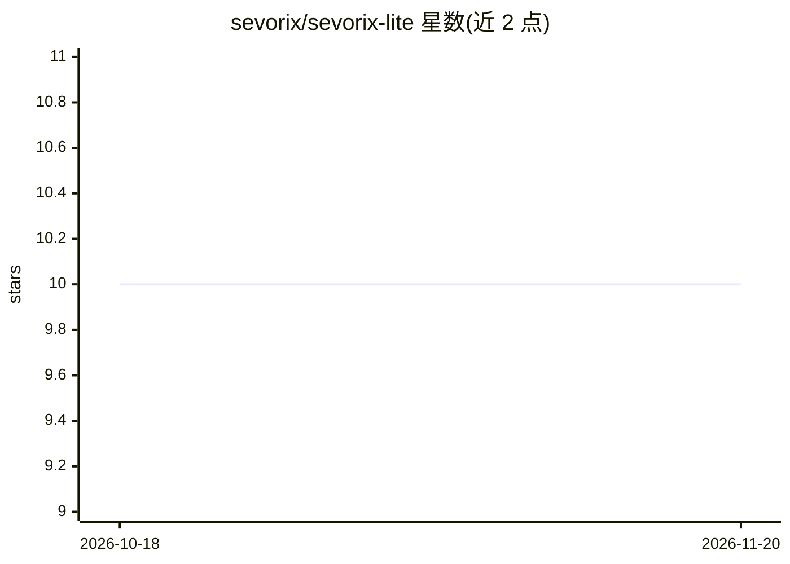

# sevorix/sevorix-lite

⭐ 10 · Rust · AGPL-3.0 · 推送 2026-06-05 · [GitHub](https://github.com/sevorix/sevorix-lite) · [官网](https://sevorix.com) · 个人维护

**为自主 AI Agent 提供运行时行为拦截与策略管控的安全引擎**

以 Rust 实现的本地运行时防火墙，在 Agent 执行动作前进行拦截、评估与放行：sevsh 包装 shell 命令、HTTP 代理拦截出站请求、Linux 上经 eBPF/seccomp 捕获系统调用。策略以 JSON 定义，支持 Simple/Regex/Executable 匹配与三车道处置（Block/Flag/Allow），Flag 动作提供带倒计时的人工审核面板（Dashboard）。提供 GitHub Release 二进制安装与源码构建；默认策略集仅为验证安装的起点，需自行编写规则。

## 筛选速览

| 维度 | 判定 | 备注 |
|---|---|---|
| AI 角色 | `ai-ecosystem` | LLM/agent 周边工具 |
| 许可风险 | `dual` | AGPL-3.0 |
| 部署形态 | `desktop` | 安装包/桌面程序 |
| 模型依赖 | — | README 未给出锁定关系 |
| 硬件要求 | — | 无带数字的原话,不猜 |
| 安装摩擦 | `medium` | 含编译或系统依赖之一 |
| 成熟度 | — | 结构信号不足 |

## 能力要点

- sevsh shell 包装 + HTTP 代理 + eBPF/seccomp 三层拦截
- JSON 策略：Simple/Regex/Executable 匹配，Shell/Network/Syscall 上下文
- 人工审核 Yellow Lane：倒计时面板中 Allow/Block 待定动作
- Linux 用 mount namespace 将 sevsh 绑定挂载覆盖 /bin/bash 以防止绕过

## 适用场景

- 限制自主编码 Agent 可执行的 shell 命令范围
- 审计并阻断 Agent 的出站网络请求
- 对敏感操作（如读取凭据）要求人工确认后放行

## 场景标签

`网络安全` · 领域:学习与行业

## 证据(README 行号)

> L3: > **Runtime Containment for Autonomous AI Agents.**
> L8: Most developers think an "AI Gateway" is enough. But if your agent gets a raw shell command or a direct network sock
> L105: ## 🤖 AI Agent Integrations (The Vault)

## 星数曲线

2026-10-18 10 → 2026-11-20 10（+0）

---
*卡片 v1 · prompt 1.4 · 生成 2026-11-19 · 置信度 high · 依据 README sha `b7f52f81c51f` · [字段定义](../../DATASET.md)*
