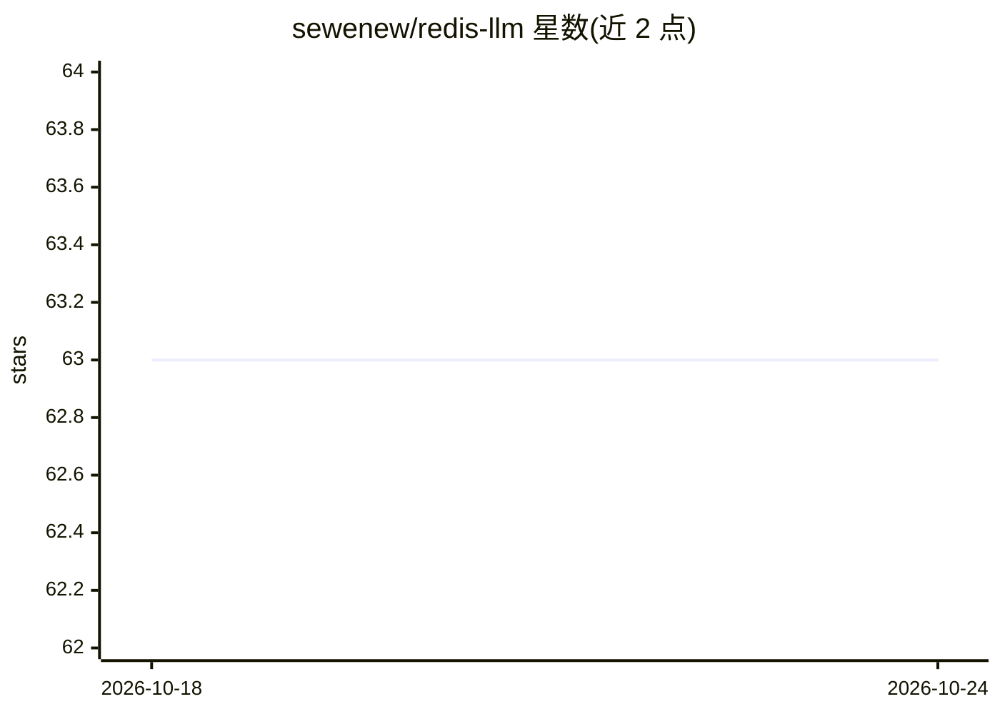

# sewenew/redis-llm

⭐ 63 · C++ · Apache-2.0 · 推送 2026-05-01 · [GitHub](https://github.com/sewenew/redis-llm) · 个人维护 · 中文 README

**把 LLM 接入 Redis 的模块：私有数据问答与长历史聊天**

用 C++ 编写的 Redis Module，将 Redis 作为 LLM 的扩展存储：内置向量存储（HNSW），可保存私有数据并让 LLM 基于其回答问题；聊天应用将对话历史索引到向量存储以突破 token 限制。通过 Redis 命令（LLM.CREATE-LLM/APP/SEARCH/CHAT/RUN）创建带 prompt 模板的应用，可经 redis-cli、redis-plus-plus（C++）、redis-py（Python）调用。当前支持 OpenAI 与 Azure OpenAI 两类模型。源码编译依赖 curl 与 openssl，需 Redis 5.0 以上。

## 筛选速览

| 维度 | 判定 | 备注 |
|---|---|---|
| AI 角色 | `ai-ecosystem` | LLM/agent 周边工具 |
| 许可风险 | `permissive` | Apache-2.0 |
| 部署形态 | `self-host` | docker 或自建部署 |
| 模型依赖 | locked-api |  |
| 硬件要求 | — | 无带数字的原话,不猜 |
| 安装摩擦 | `low` | 无编译、无系统依赖或容器化 |
| 成熟度 | — | 结构信号不足 |

## 能力要点

- Redis Module 形式，提供 LLM.CREATE/RUN 系列命令
- 向量存储（HNSW ANN）支持私有数据问答与聊天历史索引
- 支持 prompt 模板变量（{{var}}）动态渲染
- 支持 OpenAI 与 Azure OpenAI，模型参数以 JSON 配置

## 适用场景

- 在 Redis 中保存私有数据并让 LLM 基于其回答问题
- 构建带长历史记忆的聊天应用
- 用 prompt 模板创建可复用的 LLM 应用

## 场景标签

`RAG` `聊天机器人` · 领域:对话与助手

## 证据(README 行号)

> L9: redis-llm is a Redis Module that integrates LLM (Large Language Model) with Redis.
> L16: In order to solve these problems, I write redis-llm to integrate LLM with Redis. This module makes Redis an extende
> L285: Currently, we support the following applications:

## 星数曲线

2026-10-18 63 → 2026-10-24 63（+0）

---
*卡片 v1 · prompt 1.4 · 生成 2026-10-24 · 置信度 high · 依据 README sha `333cea9b0b4a` · [字段定义](../../DATASET.md)*
