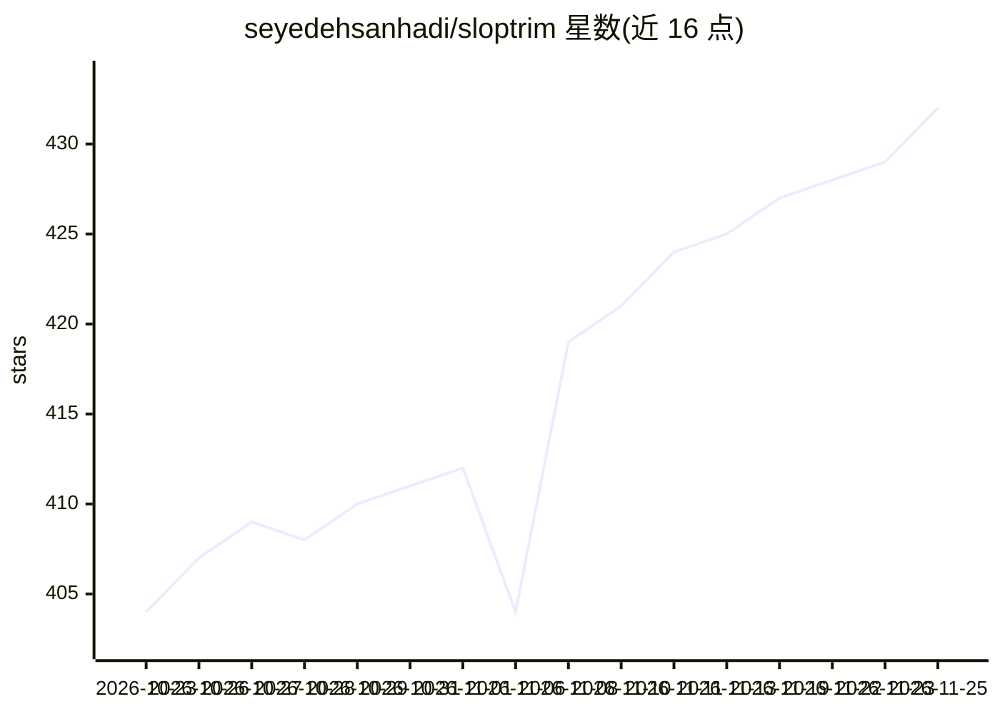

# seyedehsanhadi/sloptrim

⭐ 432 · Python · Apache-2.0 · 推送 2026-11-10 · [GitHub](https://github.com/seyedehsanhadi/sloptrim) · 个人维护

**本地检测 AI 写作模式的命令行工具与编码代理插件**

以 Claude Code 插件与命令行工具形式运行：对经支持的文件编辑工具保存的文本文件提取正文并打 0-100 分，针对 71 种已记录模式（62 种有检测器），超过阈值时要求修正被标记片段。支持 20 种格式（.docx/.pptx/.epub/.ipynb/LaTeX 等），仅纯 Python 标准库实现，无网络、无模型、不上传文本。提供 full/strict/lite/off 模式、/sloptrim check 等命令，README 明确声明它不是作者归属分类器，不可用于判断文本是否由模型写成。

## 筛选速览

| 维度 | 判定 | 备注 |
|---|---|---|
| AI 角色 | `ai-ecosystem` | LLM/agent 周边工具 |
| 许可风险 | `permissive` | Apache-2.0 |
| 部署形态 | `None` |  |
| 模型依赖 | — | README 未给出锁定关系 |
| 硬件要求 | — | 无带数字的原话,不猜 |
| 安装摩擦 | `low` | 无编译、无系统依赖或容器化 |
| 成熟度 | — | 结构信号不足 |

## 能力要点

- 0-100 评分，71 种模式中 62 种有本地检测器，纯 Python 标准库实现
- 支持 20 种格式（.docx/.pptx/.xlsx/OpenDocument/.epub/.ipynb/LaTeX）
- 以 Claude Code 插件运行于保存时，其他代理可经 /sloptrim init 写入契约
- 公开匹配基准 ROC-AUC 0.783–0.943，结果记录固定源哈希

## 适用场景

- 让编码代理保存的文档在保存时被自动打分并标记 AI 写作模式
- 用 /sloptrim check 对单个文档打分并列出命中的模式
- 在无网络的本地环境运行，不外传任何文本

## 场景标签

 · 领域:开发者工具/AI 写作检测

## 证据(README 行号)

> L18: > **This is a command-line tool and an agent plugin. There is no website and no hosted version.**
> L69: |Runs in|Claude Code, on save. Other agents via `/sloptrim init`, which writes the contract to `AGENTS.md`, and `.c
> L70: |Needs|Node for the hooks, Python 3.9 or newer for the detector, nothing else|

## 星数曲线

2026-10-23 404 → 2026-11-25 432（+28）

---
*卡片 v1 · prompt 1.4 · 生成 2026-11-25 · 置信度 high · 依据 README sha `a39791a1cada` · [字段定义](../../DATASET.md)*
