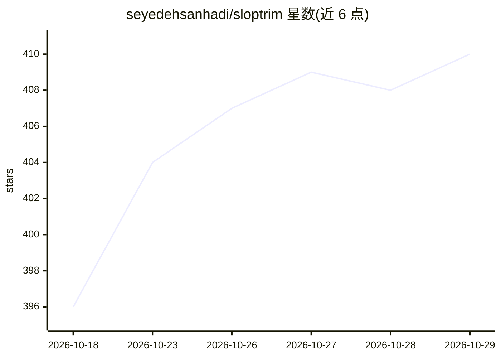

# seyedehsanhadi/sloptrim

⭐ 410 · Python · Apache-2.0 · 推送 2026-10-22 · [GitHub](https://github.com/seyedehsanhadi/sloptrim) · 个人维护

**本地 AI 写作痕迹检测插件：给 agent 保存的文本打分并要求修正**

面向 Claude Code 等 coding agent 的命令行工具与插件：通过 hooks 在文件保存时提取正文前 262,144 字符，按 71 个已文档化模式（62 个带检测器）打 0-100 分，标记可疑片段并要求修复。仅用 Python 标准库，无网络、无模型，纯词法检测。支持 20 种格式（docx/pptx/xlsx/epub/ipynb/LaTeX 等），需 Node 运行 hooks 与 Python 3.9+。README 明确声明其不能证明作者是否为模型，不得作为作者身份分类器。

## 筛选速览

| 维度 | 判定 | 备注 |
|---|---|---|
| AI 角色 | `ai-ecosystem` | LLM/agent 周边工具 |
| 许可风险 | `permissive` | Apache-2.0 |
| 部署形态 | `None` |  |
| 模型依赖 | — | README 未给出锁定关系 |
| 硬件要求 | — | 无带数字的原话,不猜 |
| 安装摩擦 | `low` | 无编译、无系统依赖或容器化 |
| 成熟度 | — | 结构信号不足 |

## 能力要点

- 对 71 个模式打 0-100 分，五个等级带（clean 至 pervasive tells）
- 20 种格式支持，含从 Office 归档与 EPUB 中读取文本
- Python 标准库实现，无网络无模型，数据不出本机
- 公开匹配基准 ROC-AUC 0.783–0.943（五个 30/30 人机对照臂）

## 适用场景

- 让 coding agent 保存文档时自动检查并修正 AI 写作痕迹
- 对草稿文件单独打分查看命名模式，不做改写
- 在 Cursor 等其他 agent 中通过 AGENTS.md 契约接入

## 场景标签

 · 领域:开发者工具/文本检测

## 证据(README 行号)

> L18: > **This is a command-line tool and an agent plugin. There is no website and no hosted version.**
> L69: |Runs in|Claude Code, on save. Other agents via `/sloptrim init`, which writes the contract to `AGENTS.md`, and `.c
> L70: |Needs|Node for the hooks, Python 3.9 or newer for the detector, nothing else|

## 星数曲线

2026-10-18 396 → 2026-10-29 410（+14）

---
*卡片 v1 · prompt 1.4 · 生成 2026-10-22 · 置信度 high · 依据 README sha `3e650e80d328` · [字段定义](../../DATASET.md)*
