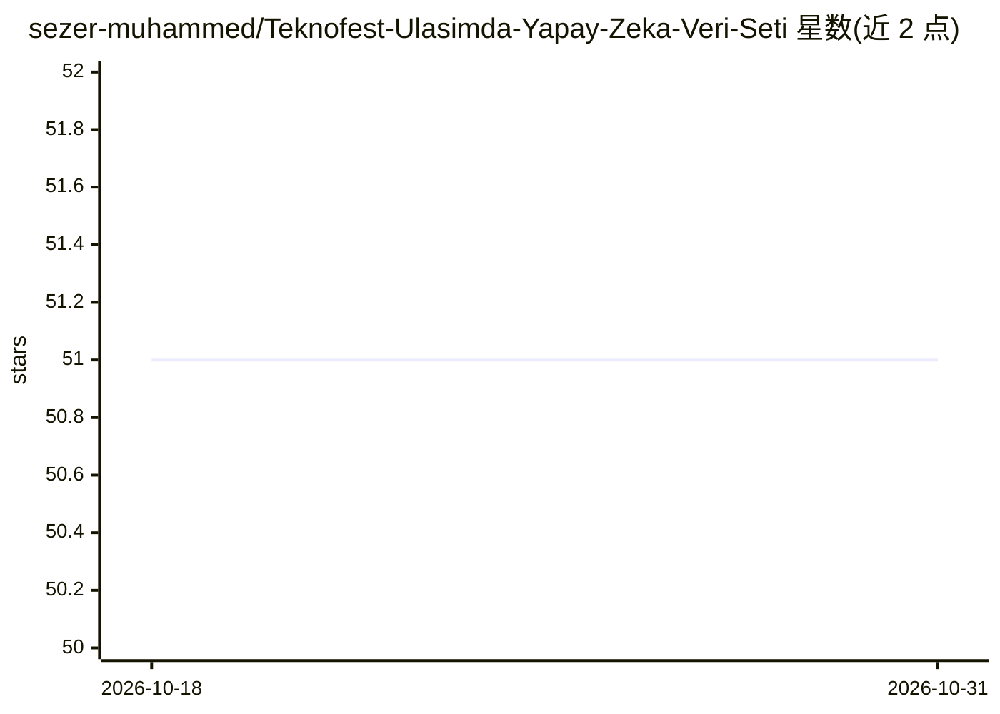

# sezer-muhammed/Teknofest-Ulasimda-Yapay-Zeka-Veri-Seti

⭐ 51 · 推送 2026-01-02 · [GitHub](https://github.com/sezer-muhammed/Teknofest-Ulasimda-Yapay-Zeka-Veri-Seti) · 组织维护

**2022 Teknofest 交通赛俯视图目标检测数据集**

面向 2022 年 Teknofest 交通人工智能竞赛的数据集仓库：包含约 25,000 张俯视（top-down）标注图像，涵盖人员、车辆与停机坪，来自库存视频与摄影素材。标注为 YOLO 格式（class_id 与归一化框坐标），共 300,000+ 条标注，目录结构含 train/、test/ 文件夹与 dataset.yaml 配置文件，可直接用于 YOLOv5、YOLOv8 等检测模型训练。由竞赛第一、二名队伍（Eflatun Team）使用的数据组成。

## 筛选速览

| 维度 | 判定 | 备注 |
|---|---|---|
| AI 角色 | `ai-knowledge` | 知识聚合/清单类 |
| 许可风险 | `none` | — |
| 部署形态 | `None` |  |
| 模型依赖 | — | README 未给出锁定关系 |
| 硬件要求 | — | 无带数字的原话,不猜 |
| 安装摩擦 | `low` | 无编译、无系统依赖或容器化 |
| 成熟度 | — | 结构信号不足 |

## 能力要点

- 25,000+ 张俯视航拍图像，300,000+ 条 YOLO 格式标注
- 类别：Vehicle、Pedestrian（另含 helipad 标注）
- 包含 train/test 目录与 dataset.yaml 配置，兼容 YOLOv5/YOLOv8

## 适用场景

- 训练俯视角度的车辆与行人检测模型
- 参加交通领域目标检测竞赛或复现相关结果
- 获取带 YOLO 标注的航拍小目标检测练习数据

## 场景标签

`目标检测` · 领域:感知与多模态

## 证据(README 行号)

> L13: This repository contains the dataset used by the first and second place teams in the 2022 Teknofest Artificial Inte
> L20: - Format: **YOLO-style annotations**

## 星数曲线

2026-10-18 51 → 2026-10-31 51（+0）

---
*卡片 v1 · prompt 1.4 · 生成 2026-10-24 · 置信度 high · 依据 README sha `3629bbc2552f` · [字段定义](../../DATASET.md)*
