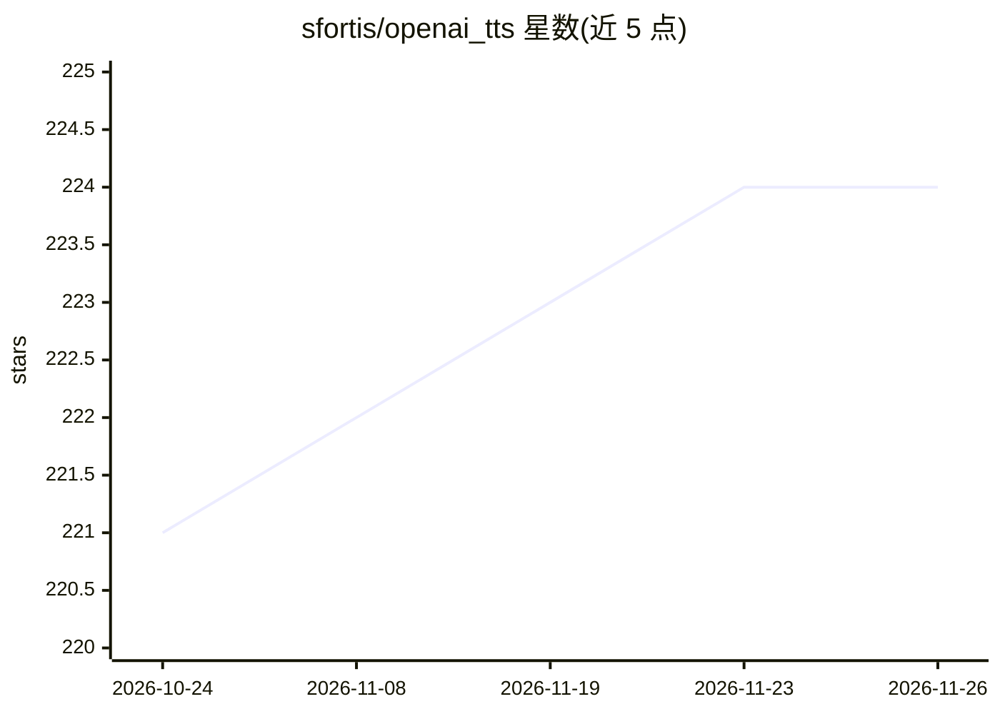

# sfortis/openai_tts

⭐ 224 · Python · GPL-3.0 · 推送 2026-11-12 · [GitHub](https://github.com/sfortis/openai_tts) · 个人维护

**Home Assistant 的多供应商 TTS 集成：支持云端与自托管语音合成**

面向 Home Assistant 用户的文本转语音集成，通过 OpenAI speech API 规范接入多个服务：内置 OpenAI、OpenAI Realtime、Mistral、Groq、Lemonfox、OpenRouter、Kokoro-FastAPI、Chatterbox 及 Custom 共 9 类预设，自动填充端点、模型与声音列表。支持每个条目配置多个 TTS agent，音频格式覆盖 mp3/opus/aac/flac/wav/pcm，提供流式播放、句级流式、逐 profile 增益与响度校正，公告播放时可压低并恢复音乐音量。通过 HACS 分发，要求 Home Assistant 2026.9.1 及以上（3.10 起）。

## 筛选速览

| 维度 | 判定 | 备注 |
|---|---|---|
| AI 角色 | `ai-native` | 本体是模型或模型工具 |
| 许可风险 | `viral` | GPL-3.0 |
| 部署形态 | `desktop` | 安装包/桌面程序 |
| 模型依赖 | locked-api |  |
| 硬件要求 | — | 无带数字的原话,不猜 |
| 安装摩擦 | `low` | 无编译、无系统依赖或容器化 |
| 成熟度 | — | 结构信号不足 |

## 能力要点

- 9 类供应商预设，自动填充端点、模型与声音列表
- Custom 预设可接入任何实现 OpenAI speech API 的自托管服务（如 LocalAI、pocket-tts）
- 流式播放与句级流式，音频随到达随播放
- 公告时自动暂停/压低音乐并在结束后恢复音量

## 适用场景

- 让 Home Assistant 语音助手用自托管的 Kokoro 或 Chatterbox 朗读回复
- 在 Sonos 或 Music Assistant 音箱上播放带背景音乐压低效果的公告
- 通过自动化调用 openai_tts.say 向指定区域或楼层播报通知

## 场景标签

`语音合成` · 领域:内容生成

## 证据(README 行号)

> L3: **Text-to-speech for Home Assistant from OpenAI, Mistral, Groq, Lemonfox, Kokoro, Chatterbox or any server that impl
> L14: OpenAI TTS is a text-to-speech integration for Home Assistant that works with any service implementing the OpenAI s

## 星数曲线

2026-10-24 221 → 2026-11-26 224（+3）

---
*卡片 v1 · prompt 1.4 · 生成 2026-11-25 · 置信度 high · 依据 README sha `4f2074f92e40` · [字段定义](../../DATASET.md)*
