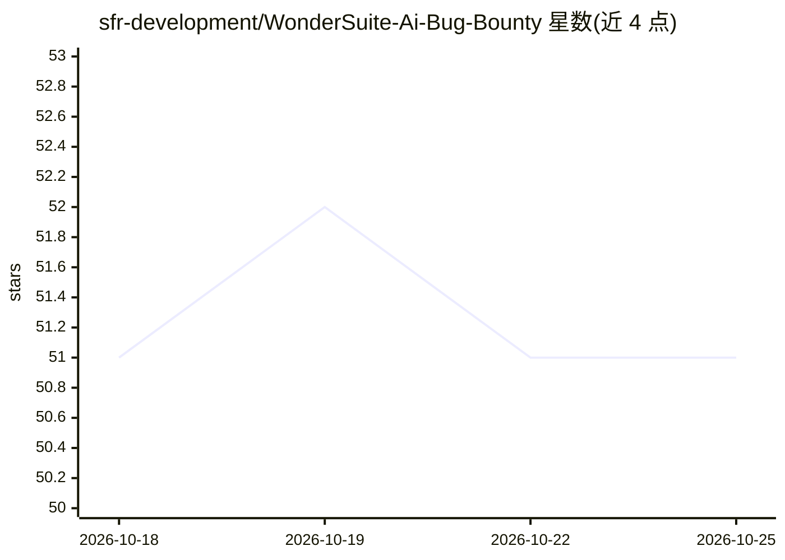

# sfr-development/WonderSuite-Ai-Bug-Bounty

⭐ 51 · Rust · MIT · 推送 2026-10-19 · [GitHub](https://github.com/sfr-development/WonderSuite-Ai-Bug-Bounty) · 组织维护

**桌面端攻击性安全测试平台：91 工具+MITM 代理+MCP 供 AI agent 调用**

基于 Rust + Tauri + React 的桌面原生 Web 安全测试平台，功能包括 TLS 拦截 MITM 代理（Chrome 137 JA3/JA4 + HTTP/2 指纹模拟）、内置 Chrome-for-Testing 148 隐身浏览器（三层隐身：TLS/浏览器扩展/输入管道）、爬虫、代码审计（60+ 正则模式检出密钥/端点）、端口扫描与自动漏扫（SQLi/XSS/SSTI 等）。91 个安全工具经 JSON-RPC / MCP 接口暴露，供 Claude 等外部 AI agent 或操作者调用驱动。提供桌面安装包下载，也可从源码构建。

## 筛选速览

| 维度 | 判定 | 备注 |
|---|---|---|
| AI 角色 | `ai-enhanced` | 去掉 AI 部分产品仍成立 |
| 许可风险 | `permissive` | MIT |
| 部署形态 | `desktop` | 安装包/桌面程序 |
| 模型依赖 | — | README 未给出锁定关系 |
| 硬件要求 | — | 无带数字的原话,不猜 |
| 安装摩擦 | `medium` | 含编译或系统依赖之一 |
| 成熟度 | — | 结构信号不足 |

## 能力要点

- 91 个安全工具通过 JSON-RPC / MCP 暴露给 AI agent 调用
- MITM 代理支持 Chrome 137 TLS 指纹模拟（JA3/JA4 + HTTP/2）
- 内置 Chrome-for-Testing 148 与三层隐身机制（fast/human/paranoid 配置）
- 代码审计引擎以 60+ 正则模式自动检出密钥、令牌、API 端点

## 适用场景

- 在授权渗透测试中做 Web 应用抓包、改包与流量分析
- 让 Claude 等 AI agent 通过 MCP 自主驱动浏览器与代理执行测试流程
- 对目标站点 JS 资产做密钥与端点泄漏扫描

## 场景标签

`网络安全` · 领域:学习与行业

## 证据(README 行号)

> L33: **WonderSuite** is a desktop native offensive security engine that combines Burp Suite-class tooling with autonomou
> L35: The platform ships with **91 purpose-built security tools** accessible via JSON-RPC (trimmed from 100 in v0.3.11 — 

## 星数曲线

2026-10-18 51 → 2026-10-25 51（+0）

---
*卡片 v1 · prompt 1.4 · 生成 2026-10-24 · 置信度 mid · 依据 README sha `7d848aaecd40` · [字段定义](../../DATASET.md)*
