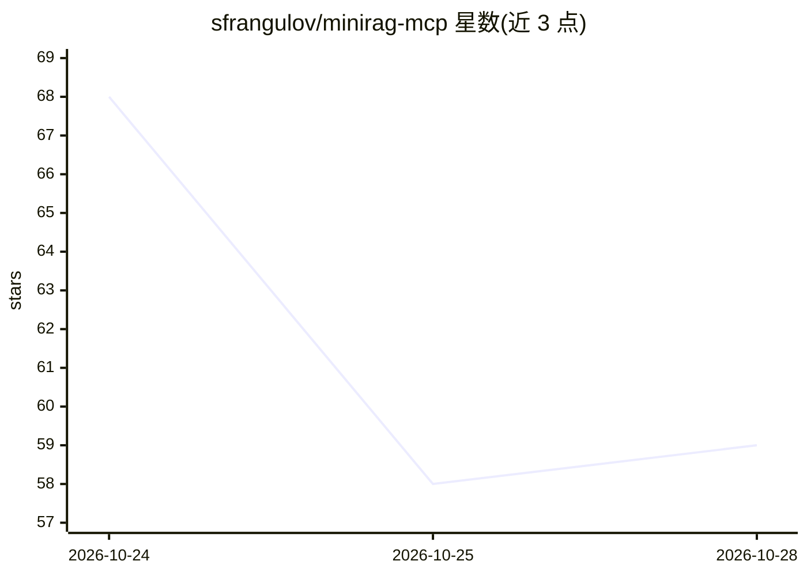

# sfrangulov/minirag-mcp

⭐ 59 · Python · MIT · 推送 2026-10-23 · [GitHub](https://github.com/sfrangulov/minirag-mcp) · 个人维护

**本地优先的 RAG MCP 服务器：为 MCP 客户端提供文档混合检索**

面向 Claude Code、Claude Desktop、Cursor、Codex 等 MCP 客户端的本地 RAG 服务器，指向文档目录后提供语义向量（fastembed/ONNX）与 BM25 关键词加权倒数排名融合的混合检索。通过 markitdown 摄取 12 种文件格式及 URL 抓取，支持 50+ 语言嵌入与 LanceDB 索引；索引与查询默认不出本机，仅首次下载嵌入模型（约 220 MB 磁盘）。提供 11 个 MCP 工具与共用同一索引的 CLI，可选 OCR 与文档分类扩展；需 Python 3.11+ 与 uv，以 uvx 从 PyPI 运行。

## 筛选速览

| 维度 | 判定 | 备注 |
|---|---|---|
| AI 角色 | `ai-ecosystem` | LLM/agent 周边工具 |
| 许可风险 | `permissive` | MIT |
| 部署形态 | `library` | 以包/库形式分发 |
| 模型依赖 | — | README 未给出锁定关系 |
| 硬件要求 | — | 无带数字的原话,不猜 |
| 安装摩擦 | `low` | 无编译、无系统依赖或容器化 |
| 成熟度 | — | 结构信号不足 |

## 能力要点

- 语义向量与 BM25 关键词加权的混合检索（Reciprocal Rank Fusion）
- markitdown 摄取 12 种文件格式，另有 URL 抓取与直接文本摄取
- 默认嵌入模型覆盖 50+ 语言，索引与查询不出本机
- MCP 服务器与 CLI 共用同一索引，提供 .miniragignore 排除规则

## 适用场景

- 让 Claude Code/Cursor 等 MCP 客户端检索本地文档目录
- 在离线环境中为 AI 客户端建立可查询的私有文档索引
- 在会议转录（.vtt）、PDF、Office 文档混合目录中做关键词+语义检索

## 场景标签

`RAG` `语义搜索` · 领域:知识与检索

## 证据(README 行号)

> L8: A local-first RAG (retrieval-augmented generation) MCP server. Point it at a
> L20: built on fastmcp,

## 星数曲线

2026-10-24 68 → 2026-10-28 59（-9）

---
*卡片 v1 · prompt 1.4 · 生成 2026-10-24 · 置信度 high · 依据 README sha `8b8e07ec18be` · [字段定义](../../DATASET.md)*
