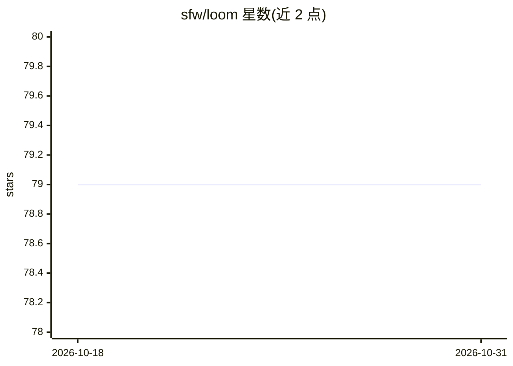

# sfw/loom

⭐ 79 · Python · MIT · 推送 2026-10-07 · [GitHub](https://github.com/sfw/loom) · 个人维护

**桌面/终端 LLM 执行 harness：分解任务并逐步验证驱动**

面向复杂任务的 LLM 执行框架：将目标分解为子任务并构建依赖图、并行执行独立子任务、用独立验证模型分三级核查结果、以结构化状态而非聊天历史维持任务，支持本地/云端/混合模型。提供 macOS 桌面应用（Tauri+React）、TUI、CLI、REST API 与 MCP 接口。内置数十种工具、模糊匹配编辑、SQLite 逐字持久化记忆、完整撤销与 YAML 流程定义。桌面端目前仅限 macOS，TUI/CLI/API 跨平台。

## 筛选速览

| 维度 | 判定 | 备注 |
|---|---|---|
| AI 角色 | `ai-ecosystem` | LLM/agent 周边工具 |
| 许可风险 | `permissive` | MIT |
| 部署形态 | `library` | 以包/库形式分发 |
| 模型依赖 | local-ok | 支持本地模型 |
| 硬件要求 | — | 无带数字的原话,不猜 |
| 安装摩擦 | `low` | 无编译、无系统依赖或容器化 |
| 成熟度 | — | 结构信号不足 |

## 能力要点

- 任务分解+依赖图并行执行+独立验证者三级核查
- 结构化状态代替聊天历史，cowork 记录逐字持久化到 SQLite
- macOS 桌面应用、TUI、CLI、REST、MCP 多种接口
- YAML 流程定义支持领域化扩展（6 个内置流程）

## 适用场景

- 把多步骤研究、编码、报告生成任务交给 harness 自主执行
- 在本地模型上运行可靠的 agent 工作流
- 通过 REST/MCP 将 Loom 作为外部 agent 的任务执行工具

## 场景标签

`Agent 框架` `工作流自动化` · 领域:Agent 开发

## 证据(README 行号)

> L7: **Desktop and terminal LLM execution harness** for complex tasks.
> L9: Loom decomposes goals, drives execution through verified steps, routes between thinking and acting models, and keeps
> L11: Bring Kimi, Minimax, GLM, Claude, or any OpenAI-compatible model and Loom supplies the harness: tool calling, struc

## 星数曲线

2026-10-18 79 → 2026-10-31 79（+0）

---
*卡片 v1 · prompt 1.4 · 生成 2026-10-24 · 置信度 high · 依据 README sha `31f13e57e9ea` · [字段定义](../../DATASET.md)*
