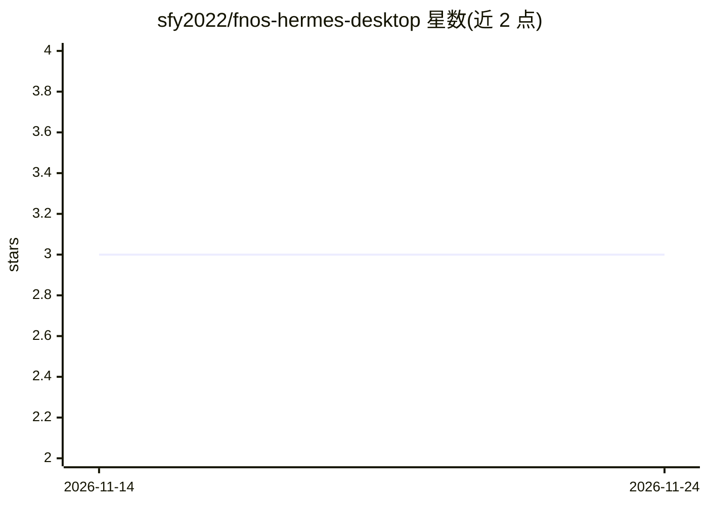

# sfy2022/fnos-hermes-desktop

⭐ 3 · Python · 推送 2026-11-05 · [GitHub](https://github.com/sfy2022/fnos-hermes-desktop) · 个人维护 · 中文 README

**把 Hermes Agent 官方 Webapp 打包成飞牛 NAS（fnOS）的 fpk 应用**

本仓库不修改上游代码，将 NousResearch/hermes-agent 的官方 Webapp 渲染层打包为 fnOS 应用（fpk），附网关适配层（剥离网关前缀、重写请求头、透传 WebSocket、放宽内嵌 CSP）和 fnOS 授权面板，用于给 Agent 开通本机或其它 fnOS 设备的模块权限。安装经飞牛应用中心手动安装 fpk，更新由 GitHub Actions 在上游发布 Release 时自动构建，版本与上游一致。浏览器版相比原生 Electron 版不含系统托盘、原生通知、麦克风等能力。

## 筛选速览

| 维度 | 判定 | 备注 |
|---|---|---|
| AI 角色 | `ai-native` | 本体是模型或模型工具 |
| 许可风险 | `none` | — |
| 部署形态 | `None` |  |
| 模型依赖 | — | README 未给出锁定关系 |
| 硬件要求 | — | 无带数字的原话,不猜 |
| 安装摩擦 | `low` | 无编译、无系统依赖或容器化 |
| 成熟度 | — | 结构信号不足 |

## 能力要点

- 上游 Webapp bundle 打包为 fpk，不修改上游代码、不需要 Electron 或虚拟显示
- 网关适配层：前缀剥离、Host/Origin 重写、WebSocket 透传、CSP 调整
- 内置 fnOS 授权面板，按模块给 Agent 开通本机或远程 fnOS 设备权限
- 上游发布 Release 时自动触发构建，应用版本与上游一致

## 适用场景

- 在飞牛 NAS 上以桌面内嵌或浏览器直连方式使用 Hermes Agent
- 让 Agent 在授权后操作 fnOS 设备的文件、Docker、存储、监控等模块
- 通过 Telegram、Discord、钉钉、飞书等消息网关与 Agent 交互

## 场景标签

`AI 助手` · 领域:对话与助手

## 证据(README 行号)

> L3: 飞牛 NAS（fnOS）上的 **Hermes Desktop 官方桌面工作区**。使用上游自带的 Webapp 形态承载，
> L9: > 上游：NousResearch/hermes-agent
> L74: - 流式对话、工具调用可视化、结构化工具摘要
> L81: - 内置飞牛 Skill：文件、Docker、应用、存储、网络、监控等

## 星数曲线

2026-11-14 3 → 2026-11-24 3（+0）

---
*卡片 v1 · prompt 1.4 · 生成 2026-11-21 · 置信度 high · 依据 README sha `86f33dfc2209` · [字段定义](../../DATASET.md)*
