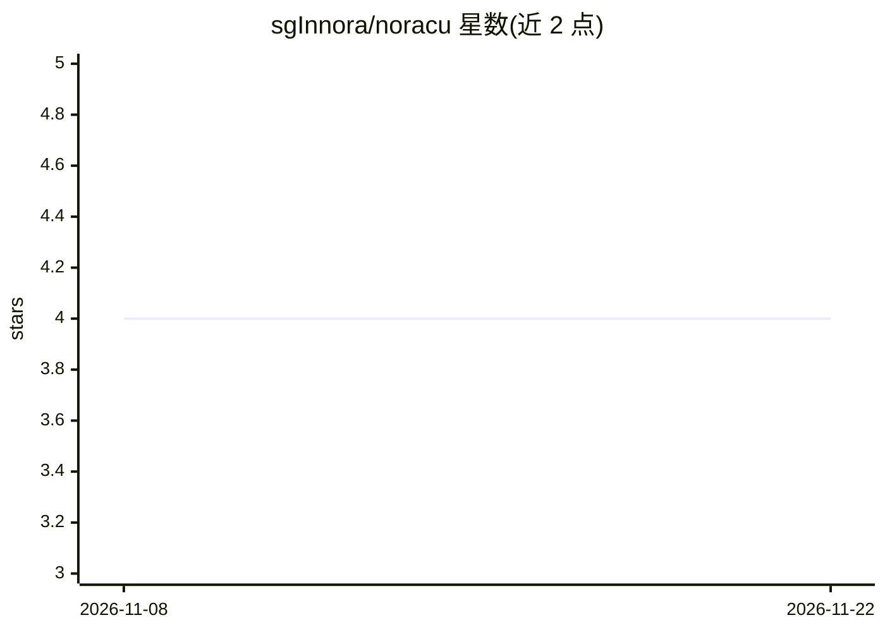

# sgInnora/noracu

⭐ 4 · JavaScript · MIT · 推送 2026-11-20 · [GitHub](https://github.com/sgInnora/noracu) · [官网](https://github.com/sgInnora/noracu#readme) · 个人维护 · 中文 README

**本地 MCP 服务器：让 MCP 客户端操作 macOS 应用与浏览器**

noracu 是一个本地运行的 MCP 服务器，向 Claude Desktop、Claude Code、Cursor 等 MCP 客户端提供 56 个工具，分四层：通过 macOS 辅助功能 API 与 cliclick 操作 Mac 应用（20 个工具），通过 Playwright 驱动浏览器（13 个），iPhone Mirroring 与 XCUITest 两个实验层（默认关闭）。机制是先取快照（辅助功能树/ARIA 树）生成带索引的元素列表，再按 element_index 操作并回报投递结果。无 API key、无遥测；需授予客户端辅助功能与屏幕录制权限，macOS 15+。

## 筛选速览

| 维度 | 判定 | 备注 |
|---|---|---|
| AI 角色 | `ai-ecosystem` | LLM/agent 周边工具 |
| 许可风险 | `permissive` | MIT |
| 部署形态 | `library` | 以包/库形式分发 |
| 模型依赖 | — | README 未给出锁定关系 |
| 硬件要求 | — | 无带数字的原话,不猜 |
| 安装摩擦 | `low` | 无编译、无系统依赖或容器化 |
| 成熟度 | — | 结构信号不足 |

## 能力要点

- 按 element_index 操作元素而非像素，操作前重新定位元素
- 每次输入回报 delivered_verified/unverified 等投递状态与重试安全性
- 用户优先机制：检测到键鼠使用中则暂停输入并应答 user_active
- 提供只读、停机文件、应用白名单等安全开关

## 适用场景

- 让 Claude Desktop/Cursor 用自然语言代为操作 Finder、Notes 等 macOS 应用
- 在自己授权的 Chrome 里打开页面、读取并操作网页元素
- 通过 iPhone Mirroring 在 Mac 上查看与操作 iPhone 屏幕
- 以只读模式巡检屏幕与页面内容

## 场景标签

`浏览器自动化` `GUI 自动化` · 领域:效率与自动化

## 证据(README 行号)

> L3: **A local MCP server that lets an MCP client (Claude Desktop, Claude Code, Cursor, …) operate macOS apps
> L126: - No model inside: noracu observes and acts, your MCP client decides.

## 星数曲线

2026-11-08 4 → 2026-11-22 4（+0）

---
*卡片 v1 · prompt 1.4 · 生成 2026-11-21 · 置信度 high · 依据 README sha `8628c7e494dd` · [字段定义](../../DATASET.md)*
