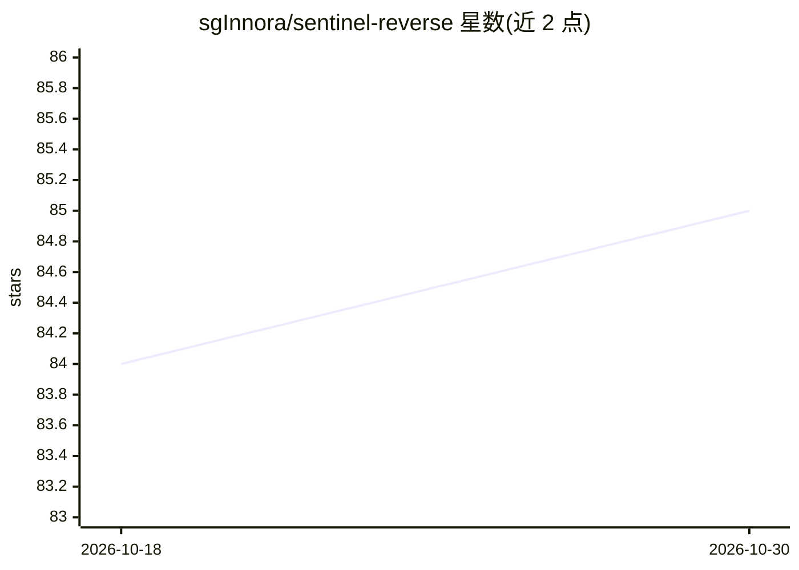

# sgInnora/sentinel-reverse

⭐ 85 · Python · MIT · 推送 2026-02-05 · [GitHub](https://github.com/sgInnora/sentinel-reverse) · [官网](https://innora.ai) · 组织维护 · 中文 README

**面向 Apple Silicon 的本地 LLM 二进制逆向分析 CLI**

Innora-Sentinel 平台逆向引擎的开源抽取版，以 CLI 与 Python API 形式提供：通过 radare2 解析二进制（ELF/PE/Mach-O/APK/DEX/JAR 等 8 类格式），用 Apple MLX 运行本地指令模型做多轮迭代反编译、变量命名与漏洞检测，PyTorch MPS 计算函数嵌入与相似度，支持多模型投票与按阶段检查点续跑。要求 macOS Apple Silicon、Python 3.10+ 与 MLX 格式模型，全部推理本地完成，输出 Markdown 与 JSON 报告。

## 筛选速览

| 维度 | 判定 | 备注 |
|---|---|---|
| AI 角色 | `ai-native` | 本体是模型或模型工具 |
| 许可风险 | `permissive` | MIT |
| 部署形态 | `library` | 以包/库形式分发 |
| 模型依赖 | — | README 未给出锁定关系 |
| 硬件要求 | `gpu-8g` | |
| 安装摩擦 | `medium` | 含编译或系统依赖之一 |
| 成熟度 | — | 结构信号不足 |

## 能力要点

- MLX 本地 LLM 多轮迭代分析（4 种策略、quick/standard/exhaustive/security 模式）
- MPS GPU 加速的函数嵌入与相似度搜索，统一内存分阶段管理
- 支持 ELF/PE/Mach-O/.NET/APK/DEX/JAR/胖二进制 8 类格式
- 多模型投票与分阶段检查点（--resume 续跑）

## 适用场景

- 在 Apple Silicon 上离线做恶意样本与固件的深度逆向
- CTF 赛题的快速分诊与自动化分析
- 商业软件漏洞研究与 .NET/Android 应用安全审计

## 场景标签

`网络安全` · 领域:学习与行业

## 证据(README 行号)

> L27: |Function decompilation|Manual reading|**AI-driven** with iterative refinement|
> L48: |**MLX Engine**|Local LLM inference via Apple MLX — 6 task-specific prompt templates, LRU cache, dual-layer fallbac
> L50: |**Iterative Analyzer**|Multi-round confidence-driven analysis — 4 strategies (full_reverse, quick_decompile, secur

## 星数曲线

2026-10-18 84 → 2026-10-30 85（+1）

---
*卡片 v1 · prompt 1.4 · 生成 2026-10-24 · 置信度 mid · 依据 README sha `f845ecd224bc` · [字段定义](../../DATASET.md)*
