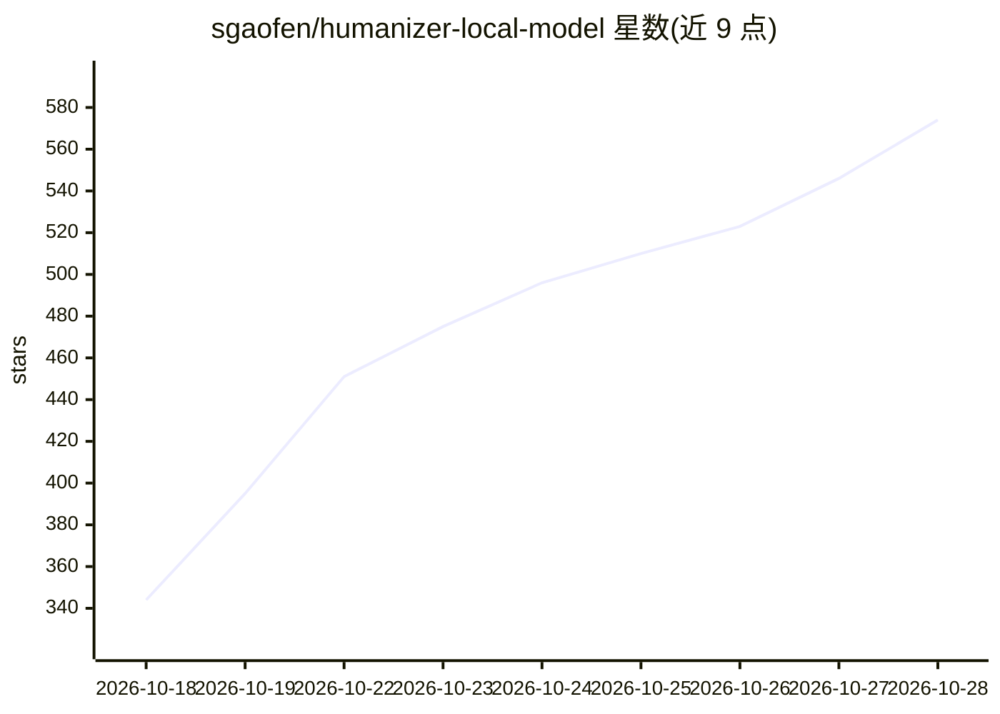

# sgaofen/humanizer-local-model

⭐ 593 · Python · Apache-2.0 · 推送 2026-10-19 · [GitHub](https://github.com/sgaofen/humanizer-local-model) · [官网](https://huggingface.co/jialinyyzz/humanizer) · 个人维护 · 中文 README

**本地运行的 12B 模型：把 AI 草稿改写得像人写的**

基于 gemma 微调的 12B 文本补全模型，重写英文与中文的 AI 生成草稿（邮件、报告、论文段落、论坛帖等），训练目标是保留所有数字、单位、日期、人名与引文且不新增内容，在本机离线运行。提供三种使用方式：macOS/Windows 桌面应用（首次联网下载模型后离线）、llama.cpp 一条命令启动本地服务、命令行工具 hz 整篇处理文件。提供五种量化规格 GGUF 文件，低至 8GB 内存可用；评估显示 95% 英文改写被判为人写，44/420 存在事实问题，README 明确提醒使用前需人工核对数字与名字。

## 筛选速览

| 维度 | 判定 | 备注 |
|---|---|---|
| AI 角色 | `ai-native` | 本体是模型或模型工具 |
| 许可风险 | `permissive` | Apache-2.0 |
| 部署形态 | `desktop` | 安装包/桌面程序 |
| 模型依赖 | local-ok | 支持本地模型 |
| 硬件要求 | — | 无带数字的原话,不猜 |
| 安装摩擦 | `medium` | 含编译或系统依赖之一 |
| 成熟度 | — | 结构信号不足 |

## 能力要点

- 保留数字/单位/日期/人名/引文的事实保留训练目标
- 2-bit/Q3/Q4 量化经量化感知训练，3.9GB 文件达到 87% top-1 一致率
- 桌面应用支持 .docx/PDF 导入、选定段落逐字保留、长文分段续写
- hz 命令行整篇重写 Markdown/.docx 并逐段报告数字丢失或新增

## 适用场景

- 把 AI 起草的邮件、报告改写后直接使用
- 在本地离线重写长篇 Markdown 或 Word 文档且保留结构与代码块
- 内存有限的电脑上选择小体积量化模型运行

## 场景标签

`AI 写作` · 领域:内容生成

## 证据(README 行号)

> L13: **humanizer** is a 12B model that rewrites AI-written drafts (emails, essays, reports, forum posts; English and Chi
> L78: # 1) start a local server; the first run downloads humanizer-12b-Q8_0.gguf (about 12.7 GB)

## 星数曲线

2026-10-18 344 → 2026-10-28 574（+230）

---
*卡片 v1 · prompt 1.4 · 生成 2026-10-21 · 置信度 high · 依据 README sha `2016a3cd8021` · [字段定义](../../DATASET.md)*
