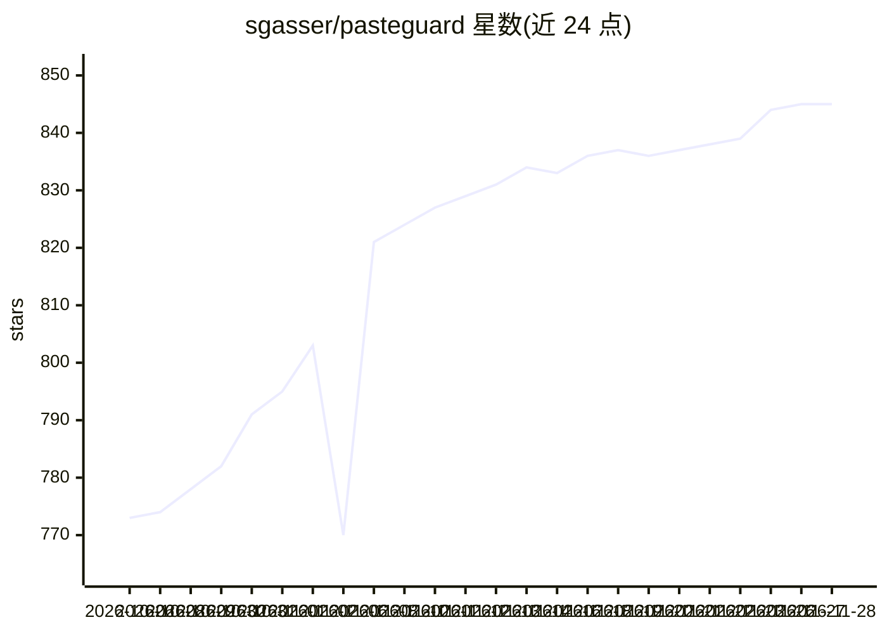

# sgasser/pasteguard

⭐ 845 · TypeScript · Apache-2.0 · 推送 2026-11-27 · [GitHub](https://github.com/sgasser/pasteguard) · [官网](https://pasteguard.com) · 个人维护

**本地隐私代理：发往 AI 前脱敏 PII 与密钥**

面向无法将客户数据、日志、凭证直接发给模型供应商的团队，PasteGuard 在请求到达 AI 供应商前对姓名、邮箱、API 密钥等做脱敏替换，响应中的占位符再还原，用户保留原文。可在浏览器聊天、应用 API（改一个 base URL 接入）与编程 Agent 三个场景工作。提供 Mask 与 Route 两种模式：前者统一脱敏，后者将含敏感数据的请求路由到本地 LLM。检测结合格式校验与 GLiNER 语义后端，支持多语言并处理流式响应，另有记录脱敏详情的仪表盘。

## 筛选速览

| 维度 | 判定 | 备注 |
|---|---|---|
| AI 角色 | `ai-ecosystem` | LLM/agent 周边工具 |
| 许可风险 | `permissive` | Apache-2.0 |
| 部署形态 | `self-host` | docker 或自建部署 |
| 模型依赖 | local-ok | 支持本地模型 |
| 硬件要求 | — | 无带数字的原话,不猜 |
| 安装摩擦 | `low` | 无编译、无系统依赖或容器化 |
| 成熟度 | — | 结构信号不足 |

## 能力要点

- 三类场景：浏览器聊天、应用 API 代理、编程 Agent 上下文脱敏
- Route Mode 将含敏感数据的请求路由到 Ollama/vLLM/llama.cpp 本地 LLM
- 检测覆盖姓名/位置/银行卡/中国身份证等多语言 PII 与多家供应商 API 密钥
- 每个请求记录脱敏详情的仪表盘

## 适用场景

- 把客户工单或合同粘贴给 ChatGPT 前自动脱敏
- 内部 AI 产品只需改 base URL 即可接入隐私管道
- 编程 Agent 提交日志与堆栈前拦截其中的密钥与 PII
- 合规要求下对敏感请求改走本地模型

## 场景标签

 · 领域:LLM 基础设施/数据隐私

## 证据(README 行号)

> L22: PasteGuard is a local-first privacy layer for teams that cannot send raw client data, customer records, logs, crede
> L36: **Apps, SDKs, and internal AI products.** Point your application to PasteGuard instead of the provider directly.
> L103: Route Mode sends requests containing sensitive data to a local LLM such as Ollama, vLLM, or llama.cpp. Requests wi

## 星数曲线

2026-10-26 773 → 2026-11-28 845（+72）

---
*卡片 v1 · prompt 1.4 · 生成 2026-11-24 · 置信度 high · 依据 README sha `782704bcc2a0` · [字段定义](../../DATASET.md)*
