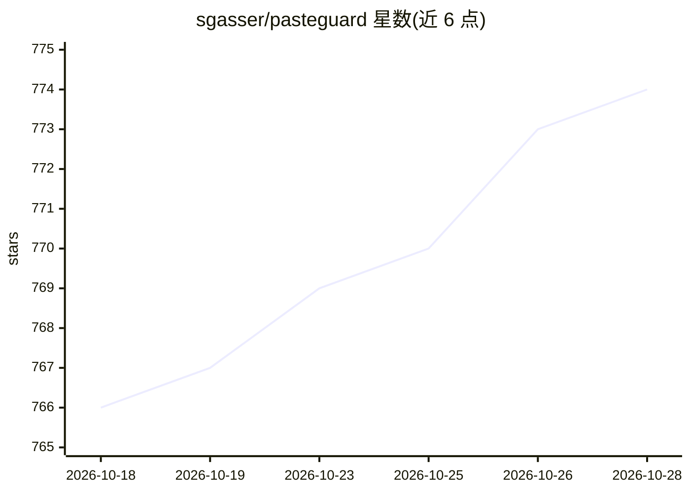

# sgasser/pasteguard

⭐ 778 · TypeScript · Apache-2.0 · 推送 2026-10-13 · [GitHub](https://github.com/sgasser/pasteguard) · [官网](https://pasteguard.com) · 个人维护

**本地隐私代理：在请求到达 AI 前掩码 PII 与密钥**

面向无法直接向模型服务商发送客户数据、凭据或生产细节的团队，PasteGuard 作为本地优先的隐私代理层运行：在请求进入 ChatGPT、Claude、OpenAI 等 provider 之前将姓名、邮箱、API 密钥等替换为占位符，用户保留原文，支持在响应中还原占位符；检测结合校验和/格式检查与 GLiNER 语义后端，覆盖流式响应。提供浏览器扩展（实验性）、API 代理与编码代理三种接入方式，含请求日志 Dashboard；Route Mode 可将含敏感数据的请求转发到本地 LLM。以 Docker 运行，技术栈为 Bun/Hono/SQLite 或 Postgres。

## 筛选速览

| 维度 | 判定 | 备注 |
|---|---|---|
| AI 角色 | `ai-ecosystem` | LLM/agent 周边工具 |
| 许可风险 | `permissive` | Apache-2.0 |
| 部署形态 | `self-host` | docker 或自建部署 |
| 模型依赖 | local-ok | 支持本地模型 |
| 硬件要求 | — | 无带数字的原话,不猜 |
| 安装摩擦 | `low` | 无编译、无系统依赖或容器化 |
| 成熟度 | `idea` | |

## 能力要点

- 请求发送前实时掩码 PII 与密钥，支持流式响应与占位符还原
- 三种接入：实验性浏览器扩展、改 base URL 的 API 代理、编码代理
- Route Mode 将含敏感数据的请求路由到本地 LLM（Ollama/vLLM/llama.cpp）
- Dashboard 记录每个请求的检测与掩码详情

## 适用场景

- 合规要求下让团队安全使用云端 AI 服务
- 防止编码代理把日志、密钥、工单中的敏感信息发出去
- 审计到达 provider 的请求中掩码了哪些内容

## 场景标签

 · 领域:LLM 基础设施/隐私工程

## 证据(README 行号)

> L36: **Apps, SDKs, and internal AI products.** Point your application to PasteGuard instead of the provider directly.
> L38: Change one base URL. PasteGuard masks the request, forwards it to the configured provider, and restores supported p
> L100: Route Mode sends requests containing sensitive data to a local LLM such as Ollama, vLLM, or llama.cpp. Requests wi

## 星数曲线

2026-10-18 766 → 2026-10-28 774（+8）

---
*卡片 v1 · prompt 1.4 · 生成 2026-10-22 · 置信度 high · 依据 README sha `54067b4b308c` · [字段定义](../../DATASET.md)*
