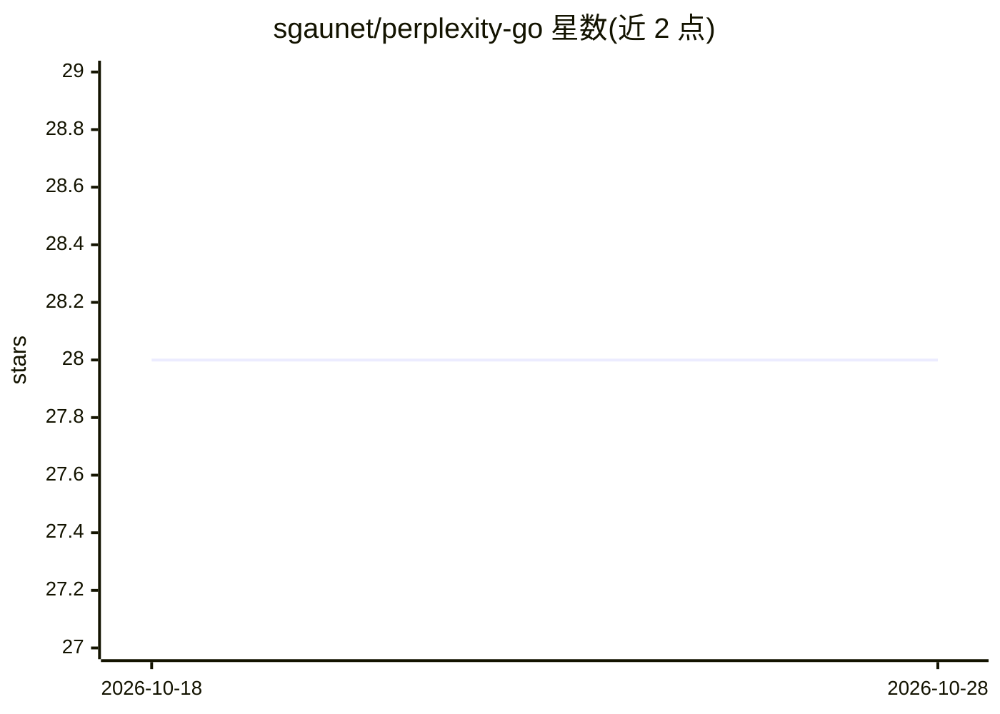

# sgaunet/perplexity-go

⭐ 28 · Go · MIT · 推送 2026-10-07 · [GitHub](https://github.com/sgaunet/perplexity-go) · 个人维护

**Go 开发者调用 Perplexity AI API 的客户端库**

轻量级 Go 库，封装 Perplexity AI API 的两类接口：Chat Completions（含流式、多模态、结构化输出）与 Search API（直接访问实时网页索引、单次最多 5 个查询、web/fast/people 三种搜索类型）。支持 API key 管理、线程安全并发请求、context 取消、请求预校验（可独立使用）与类型化错误处理（如 429 限流）。限制：v2.5.0 起仅默认模型由库持续维护，其他模型需 WithModel 自行指定；部分旧搜索参数已被 API 弃用。需自备 Perplexity API key（Search API 定价 $5/千次）。

## 筛选速览

| 维度 | 判定 | 备注 |
|---|---|---|
| AI 角色 | `ai-ecosystem` | LLM/agent 周边工具 |
| 许可风险 | `permissive` | MIT |
| 部署形态 | `None` |  |
| 模型依赖 | — | README 未给出锁定关系 |
| 硬件要求 | — | 无带数字的原话,不猜 |
| 安装摩擦 | `low` | 无编译、无系统依赖或容器化 |
| 成熟度 | — | 结构信号不足 |

## 能力要点

- Chat Completions 与 Search API 双通道封装
- Search API 支持 5 查询合并计费、域名黑白名单与日期/语言/国家过滤
- 客户端侧请求校验器可独立复用
- 线程安全并发请求与 context 取消支持

## 适用场景

- 在 Go 服务中接入 Perplexity 联网问答与摘要
- 用 Search API 获取带排名的原始网页检索结果做数据采集
- 批量多查询搜索并合并计费以控制成本

## 场景标签

 · 领域:LLM API 客户端库

## 证据(README 行号)

> L9: A lightweight Go library for interacting with the Perplexity AI API, supporting both chat completions and the Search
> L33: go get github.com/sgaunet/perplexity-go/v2

## 星数曲线

2026-10-18 28 → 2026-10-28 28（+0）

---
*卡片 v1 · prompt 1.4 · 生成 2026-10-26 · 置信度 high · 依据 README sha `de6e7498e3cc` · [字段定义](../../DATASET.md)*
