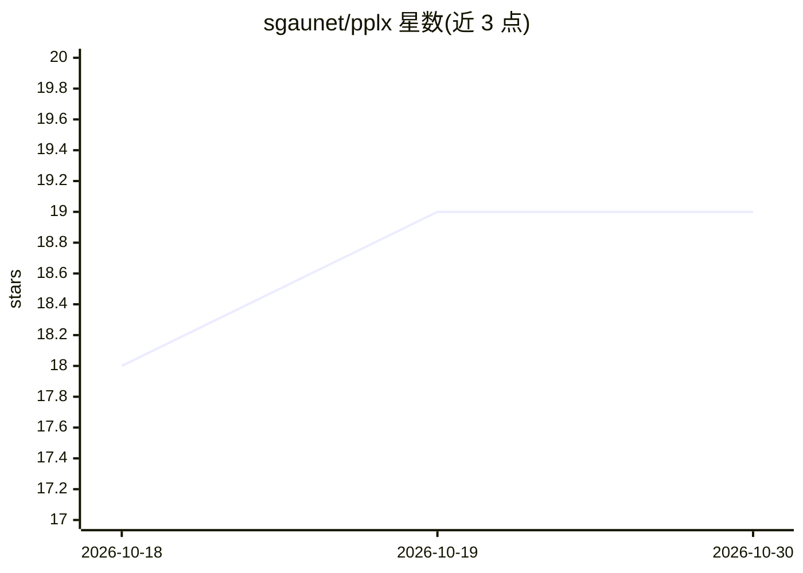

# sgaunet/pplx

⭐ 19 · Go · MIT · 推送 2026-10-08 · [GitHub](https://github.com/sgaunet/pplx) · 个人维护

**非官方 Perplexity API 命令行客户端：对话与联网查询**

Go 编写的 CLI 程序，通过 Perplexity API 提供交互式对话与查询功能，支持模型选择、搜索域过滤、时间范围过滤、web/academic 搜索模式、流式输出与图片返回等参数。提供 Bash/Zsh/Fish/PowerShell 补全、YAML 配置文件与多 profile 管理（research/news/creative 等模板），并通过 pplx mcp-stdio 命令将 Perplexity 功能以 MCP 服务器形式暴露给 Claude Code 等 MCP 兼容客户端。安装方式为下载预编译二进制、brew 或 Go 源码构建，需 Perplexity API key。

## 筛选速览

| 维度 | 判定 | 备注 |
|---|---|---|
| AI 角色 | `ai-ecosystem` | LLM/agent 周边工具 |
| 许可风险 | `permissive` | MIT |
| 部署形态 | `desktop` | 安装包/桌面程序 |
| 模型依赖 | — | README 未给出锁定关系 |
| 硬件要求 | — | 无带数字的原话,不猜 |
| 安装摩擦 | `low` | 无编译、无系统依赖或容器化 |
| 成熟度 | — | 结构信号不足 |

## 能力要点

- 交互式对话与单次查询两种模式，覆盖模型、搜索域、时间过滤等参数
- YAML 配置文件 + 多 profile + 环境变量插值的配置体系
- Bash/Zsh/Fish/PowerShell 四种 shell 补全
- pplx mcp-stdio 提供 MCP 服务器，可接入 Claude Code 等客户端

## 适用场景

- 在终端向 Perplexity 提问并做联网/学术检索
- 用不同配置 profile 切换研究、新闻、创作等工作流
- 让 Claude Code 等 MCP 客户端调用 Perplexity 查询能力

## 场景标签

`聊天机器人` `科研工具` · 领域:对话与助手

## 证据(README 行号)

> L9: It's an unofficial CLI program to query/chat with the perplexity API.
> L526: The `pplx mcp-stdio` command provides an MCP server that exposes Perplexity AI functionality to Claude Code and ot

## 星数曲线

2026-10-18 18 → 2026-10-30 19（+1）

---
*卡片 v1 · prompt 1.4 · 生成 2026-10-28 · 置信度 high · 依据 README sha `d942abb50da8` · [字段定义](../../DATASET.md)*
