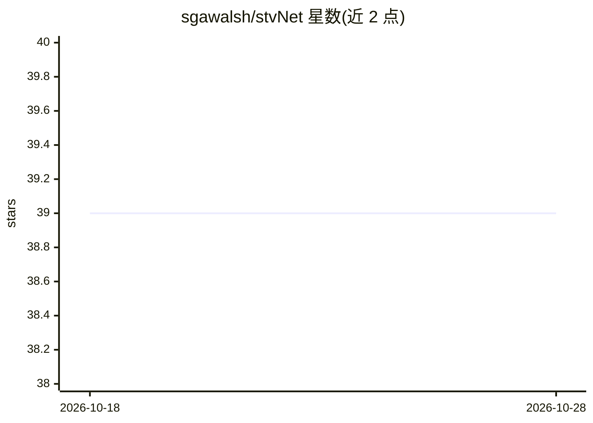

# sgawalsh/stvNet

⭐ 39 · Jupyter Notebook · 推送 2026-05-19 · [GitHub](https://github.com/sgawalsh/stvNet) · 个人维护

**基于 PVNet 论文的 6D 位姿估计模型与算法实现**

用 TensorFlow/Keras 实现 PVNet 论文所述 6D 位姿估计方案：对 RGB 图像做分割并输出逐像素关键点单位向量，经 RANSAC 投票得到 2D 关键点，再由 PnP 求解相机旋转平移。代码分 models.py（模型与训练）、data.py（LINEMOD 数据处理与生成器）、pipeLine.py（完整流程），附 demo.ipynb 演示与 YouTube 设计系列视频。需从 Kaggle 下载预格式化数据集，支持自定义模型与自定义物体的同格式数据训练。

## 筛选速览

| 维度 | 判定 | 备注 |
|---|---|---|
| AI 角色 | `ai-native` | 本体是模型或模型工具 |
| 许可风险 | `none` | — |
| 部署形态 | `None` |  |
| 模型依赖 | — | README 未给出锁定关系 |
| 硬件要求 | — | 无带数字的原话,不猜 |
| 安装摩擦 | `low` | 无编译、无系统依赖或容器化 |
| 成熟度 | — | 结构信号不足 |

## 能力要点

- 图像分割+逐像素单位向量预测+RANSAC 投票+PnP 求解的完整流水线
- 三个生成器支持关键点坐标、类别分割或两者联合训练
- 附 demo.ipynb 演示与 YouTube 系列讲解设计过程
- 可用于自定义物体的同格式数据集

## 适用场景

- 在 LINEMOD 数据集上训练并评估 6D 位姿估计模型
- 复现 PVNet 论文算法并查看逐步演示
- 为自定义物体构建同格式数据集做位姿估计

## 场景标签

`目标检测` · 领域:感知与多模态

## 证据(README 行号)

> L5: The goal of this project was to implement the 6D Pose Estimation solution described in the PVNet paper, to detect th
> L9: In brief, an RGB image is given as in input to the neural net model, which performs image segmentation, and also out

## 星数曲线

2026-10-18 39 → 2026-10-28 39（+0）

---
*卡片 v1 · prompt 1.4 · 生成 2026-10-25 · 置信度 high · 依据 README sha `46061252de2e` · [字段定义](../../DATASET.md)*
