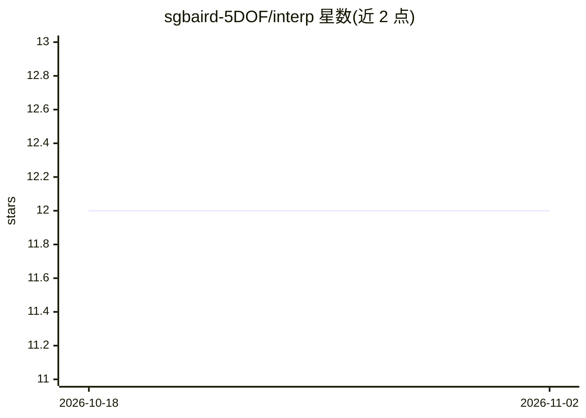

# sgbaird-5DOF/interp

⭐ 12 · MATLAB · MIT · 推送 2026-10-02 · [GitHub](https://github.com/sgbaird-5DOF/interp) · 个人维护

**MATLAB 晶界五自由度属性插值库（GPR/NN/IDW）**

面向材料科研的 MATLAB 代码库：将晶界 5 自由度表示为晶界八元数（GBO）并映射到 Voronoi 基本区（VFZ），通过自定义距离度量实现晶界能/迁移率等属性的连续插值。高层函数 interp5DOF.m 支持 GPR、重心坐标、最近邻与逆距离加权插值；另提供 VFZ 距离计算、数据格式转换、绘图复现脚本与测试函数。要求 MATLAB R2019b+ 及 Statistics and Machine Learning Toolbox；作者标注代码库正在重构修正中。

## 筛选速览

| 维度 | 判定 | 备注 |
|---|---|---|
| AI 角色 | `ai-native` | 本体是模型或模型工具 |
| 许可风险 | `permissive` | MIT |
| 部署形态 | `desktop` | 安装包/桌面程序 |
| 模型依赖 | — | README 未给出锁定关系 |
| 硬件要求 | — | 无带数字的原话,不猜 |
| 安装摩擦 | `low` | 无编译、无系统依赖或容器化 |
| 成熟度 | `idea` | |

## 能力要点

- 将晶界 5DOF 表示为八元数并映射至 Voronoi 基本区
- interp5DOF.m 支持 GPR/重心/最近邻/IDW 四种插值方案
- VFZ 距离计算（GBdist4、ensembleGBdist 向量化并行实现）
- 提供数据转换函数、figshare 论文数据与 parfor 并行支持

## 适用场景

- 对晶界能、迁移率等属性在 5DOF 空间做连续插值预测
- 计算晶界八元数在 VFZ 意义下的距离矩阵
- 复现论文图表或对自有无文献晶界数据做转换与建模

## 场景标签

`科研工具` · 领域:学习与行业

## 证据(README 行号)

> L11:  Code related to meshing, interpolation, and distance calculations of grain boundaries by representing 5DOF of grai
> L27: - Statistics and Machine Learning Toolbox (for Gaussian Process Regression: fitrgp(), fitrgp.predict())
> L39: See interp5DOF.m, which is a high-level function for Gaussian Process Regression (GPR), barycentric, nearest neighb

## 星数曲线

2026-10-18 12 → 2026-11-02 12（+0）

---
*卡片 v1 · prompt 1.4 · 生成 2026-11-01 · 置信度 high · 依据 README sha `0018ff380897` · [字段定义](../../DATASET.md)*
