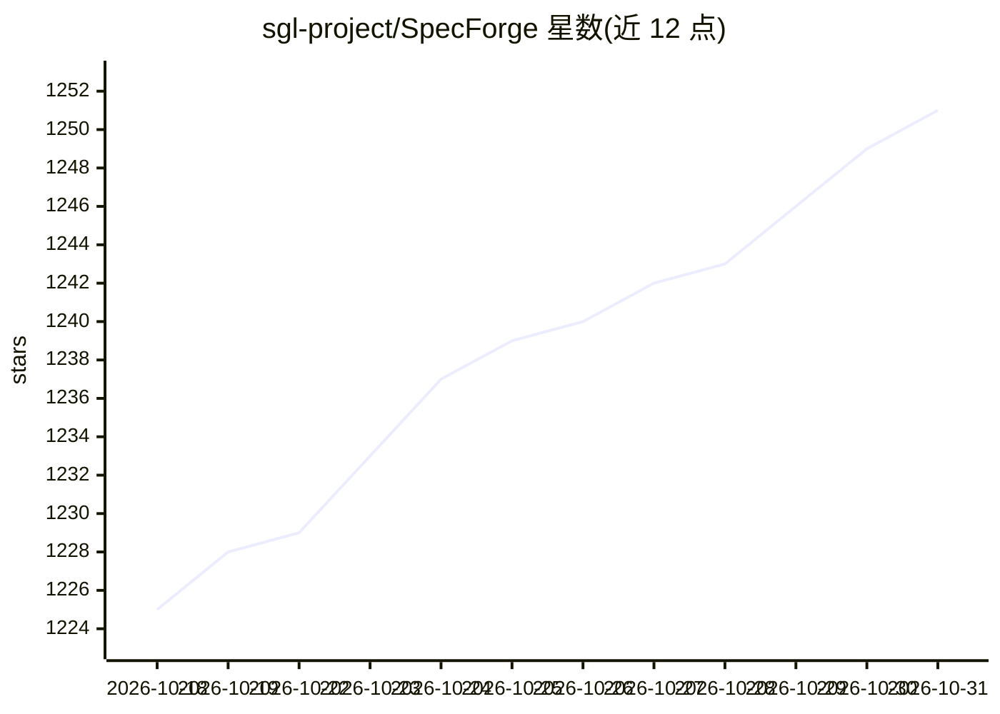

# sgl-project/SpecForge

⭐ 1,251 · Python · MIT · 推送 2026-10-30 · [GitHub](https://github.com/sgl-project/SpecForge) · [官网](https://docs.sglang.ai/SpecForge/) · 组织维护

**SGLang 团队的投机解码草稿模型训练框架**

面向 LLM 推理加速场景的训练框架：支持 EAGLE3、P-EAGLE、DFlash 系列等多种投机解码方法的草稿模型训练，涵盖在线分解式训练与共置/分解式离线训练，统一通过 specforge train 命令与 YAML 配置驱动，训练产物可直接迁移到 SGLang 服务框架。配套发布 SpecBundle 生产级草稿模型合集。由 SGLang 团队（LMSYS 旗下项目）维护，获 Meituan、NVIDIA、Voltage Park 等支持。

## 筛选速览

| 维度 | 判定 | 备注 |
|---|---|---|
| AI 角色 | `ai-ecosystem` | LLM/agent 周边工具 |
| 许可风险 | `permissive` | MIT |
| 部署形态 | `None` |  |
| 模型依赖 | — | README 未给出锁定关系 |
| 硬件要求 | — | 无带数字的原话,不猜 |
| 安装摩擦 | `low` | 无编译、无系统依赖或容器化 |
| 成熟度 | — | 结构信号不足 |

## 能力要点

- 支持 EAGLE3/P-EAGLE/DFlash/DFlash2/Domino/DSpark 等方法（含 LK loss、D-PACE 优化）
- 统一 CLI 训练入口，在线分解式与离线共置/分解式训练共用一套运行时
- 训练产物直接兼容 SGLang，无需额外移植
- SpecBundle 提供生产级草稿模型，官方称推理加速最高 4x

## 适用场景

- 训练可接入 SGLang 的投机解码草稿模型
- 为自研基座模型配套草稿模型以加速推理服务
- 研究不同投机解码方法在多种并行拓扑下的训练

## 场景标签

`模型训练` `微调` · 领域:训练与推理

## 证据(README 行号)

> L13: SpecForge is an ecosystem project developed by the SGLang team. It is a framework for training speculative decoding
> L41: |Method|Description|Example config|Optimization|

## 星数曲线

2026-10-18 1,225 → 2026-10-31 1,251（+26）

---
*卡片 v1 · prompt 1.4 · 生成 2026-10-21 · 置信度 high · 依据 README sha `fa89be3e225c` · [字段定义](../../DATASET.md)*
