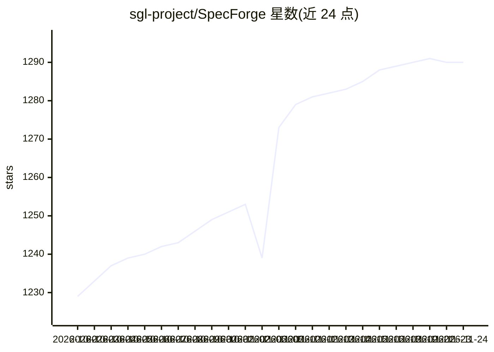

# sgl-project/SpecForge

⭐ 1,290 · Python · MIT · 推送 2026-11-24 · [GitHub](https://github.com/sgl-project/SpecForge) · [官网](https://docs.sglang.ai/SpecForge/) · 组织维护

**为 SGLang 训练投机解码模型的框架**

SGLang 团队开发的投机解码模型训练框架：统一以 `specforge train --config` 入口训练 EAGLE3、P-EAGLE、DFlash、DMTP、Domino 等 9 种草稿模型，支持在线/离线的聚合与分离式训练，覆盖数据、张量与序列并行拓扑。训练完成的模型可直接移植到 SGLang 推理框架使用，无需额外移植工作。配套发布 SpecBundle 生产级草稿模型集合，目标用户是使用 SGLang 做 LLM 推理的工程与研究人员。

## 筛选速览

| 维度 | 判定 | 备注 |
|---|---|---|
| AI 角色 | `ai-ecosystem` | LLM/agent 周边工具 |
| 许可风险 | `permissive` | MIT |
| 部署形态 | `None` |  |
| 模型依赖 | — | README 未给出锁定关系 |
| 硬件要求 | — | 无带数字的原话,不猜 |
| 安装摩擦 | `low` | 无编译、无系统依赖或容器化 |
| 成熟度 | — | 结构信号不足 |

## 能力要点

- 9 种投机解码训练方法共用同一类型化训练入口
- 支持在线/离线、聚合/分离式训练及并行拓扑组合
- 训练产物直接兼容 SGLang serving，无需移植
- 发布 SpecBundle 生产级草稿模型集合（Hugging Face）

## 适用场景

- 为 SGLang 推理服务训练自有的草稿模型
- 在线分离式训练大规模投机解码模型
- 直接选用 SpecBundle 现成草稿模型加速推理

## 场景标签

`模型训练` · 领域:训练与推理

## 证据(README 行号)

> L13: SpecForge is an ecosystem project developed by the SGLang team. It is a framework for training speculative decoding
> L43: |**EAGLE3**|Feature-based autoregressive drafting|Online external / Offline colocated / Offline disaggregated|LK lo

## 星数曲线

2026-10-22 1,229 → 2026-11-24 1,290（+61）

---
*卡片 v1 · prompt 1.4 · 生成 2026-11-23 · 置信度 high · 依据 README sha `64784aa3bae1` · [字段定义](../../DATASET.md)*
