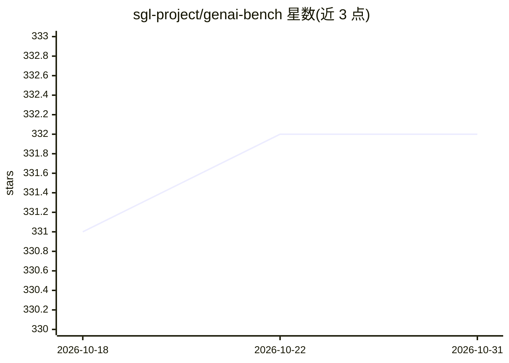

# sgl-project/genai-bench

⭐ 332 · Python · MIT · 推送 2026-10-14 · [GitHub](https://github.com/sgl-project/genai-bench) · [官网](http://docs.sglang.ai/genai-bench/) · 组织维护

**面向 LLM 服务系统的 token 级性能基准测试工具**

由 sgl-project 维护的 LLM serving 评测工具：通过 CLI 对指定后端（OpenAI 兼容 API 地址）发起基准测试，采集吞吐、TTFT/E2E/TPOT 延迟、错误率、RPS 等 token 级指标，并按流量场景与并发级别分组。提供实时监控进度的 Live UI 仪表盘、自动落盘的日志，以及生成 Excel 报告（含定价与原始指标）和可自定义布局的可视化图表（默认 2x4 网格、支持多线对比）。以 pip 安装的 Python 包形式提供。

## 筛选速览

| 维度 | 判定 | 备注 |
|---|---|---|
| AI 角色 | `ai-ecosystem` | LLM/agent 周边工具 |
| 许可风险 | `permissive` | MIT |
| 部署形态 | `library` | 以包/库形式分发 |
| 模型依赖 | — | README 未给出锁定关系 |
| 硬件要求 | — | 无带数字的原话,不猜 |
| 安装摩擦 | `low` | 无编译、无系统依赖或容器化 |
| 成熟度 | — | 结构信号不足 |

## 能力要点

- token 级指标评测：吞吐、TTFT/E2E/TPOT 延迟、错误率、RPS
- Live UI 仪表盘实时展示进度、日志与指标
- 生成含定价与原始指标的 Excel 报告
- 可自定义布局的可视化（默认 2x4 网格、多线对比）

## 适用场景

- 评测自建 LLM 推理服务的吞吐与延迟
- 对比不同并发与流量场景下的 serving 性能
- 将压测结果整理为 Excel 报告与图表

## 场景标签

`模型评测` · 领域:评测与运维

## 证据(README 行号)

> L19: Genai-bench is a powerful benchmark tool designed for comprehensive token-level performance evaluation of large lan
> L28: - 📈 **Experiment Analyzer**: Generates comprehensive Excel reports with pricing and raw metrics data, plus flexible

## 星数曲线

2026-10-18 331 → 2026-10-31 332（+1）

---
*卡片 v1 · prompt 1.4 · 生成 2026-10-21 · 置信度 high · 依据 README sha `2bb69f761acf` · [字段定义](../../DATASET.md)*
