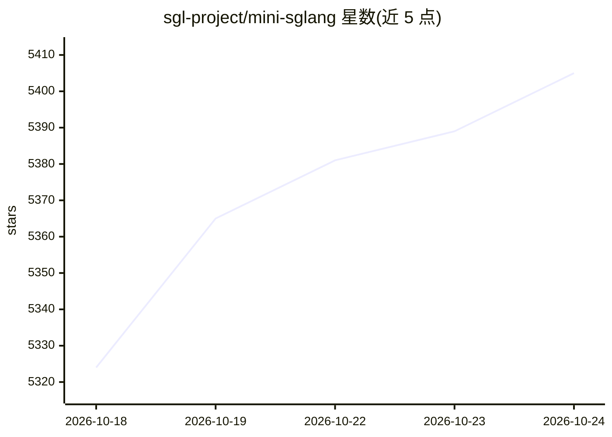

# sgl-project/mini-sglang

⭐ 5,411 · Python · MIT · 推送 2026-05-17 · [GitHub](https://github.com/sgl-project/mini-sglang) · 组织维护

**SGLang 的紧凑实现：约 5000 行的 LLM 推理服务框架**

sgl-project 维护的 LLM 推理框架，是 SGLang 的精简实现（约 5,000 行 Python），定位既是可运行的推理引擎，也是供研究与开发者理解现代 LLM serving 系统的参考实现。提供 Radix Cache、Chunked Prefill、Overlap Scheduling、张量并行等优化，集成 FlashAttention 与 FlashInfer 内核。支持 OpenAI 兼容 API 服务器与终端交互模式。仅支持 Linux（x86_64/aarch64），依赖 NVIDIA CUDA Toolkit 与 JIT 编译的 CUDA 内核，Windows/macOS 需经 WSL2 或 Docker 使用；从源码安装或 Docker 构建，无 pip 包发布。

## 筛选速览

| 维度 | 判定 | 备注 |
|---|---|---|
| AI 角色 | `ai-ecosystem` | LLM/agent 周边工具 |
| 许可风险 | `permissive` | MIT |
| 部署形态 | `self-host` | docker 或自建部署 |
| 模型依赖 | — | README 未给出锁定关系 |
| 硬件要求 | — | 无带数字的原话,不猜 |
| 安装摩擦 | `low` | 无编译、无系统依赖或容器化 |
| 成熟度 | — | 结构信号不足 |

## 能力要点

- 约 5,000 行 Python 的紧凑实现，兼作推理引擎与参考实现
- Radix Cache / Chunked Prefill / Overlap Scheduling / 张量并行等优化
- 集成 FlashAttention 与 FlashInfer 内核
- OpenAI 兼容 API 服务器与终端 shell 交互模式

## 适用场景

- 部署 OpenAI 兼容的 LLM 推理服务（含多 GPU 张量并行）
- 研读现代 LLM serving 系统的实现机制
- 在终端直接与模型对话测试

## 场景标签

`推理引擎` · 领域:训练与推理

## 证据(README 行号)

> L3: A **lightweight yet high-performance** inference framework for Large Language Models.
> L5: Mini-SGLang is a compact implementation of SGLang, designed to demystify the complexities of modern LLM serving syst
> L103: Launch an OpenAI-compatible API server with a single command.

## 星数曲线

2026-10-18 5,324 → 2026-10-24 5,405（+81）

---
*卡片 v1 · prompt 1.4 · 生成 2026-10-20 · 置信度 mid · 依据 README sha `aa0d815e56cf` · [字段定义](../../DATASET.md)*
