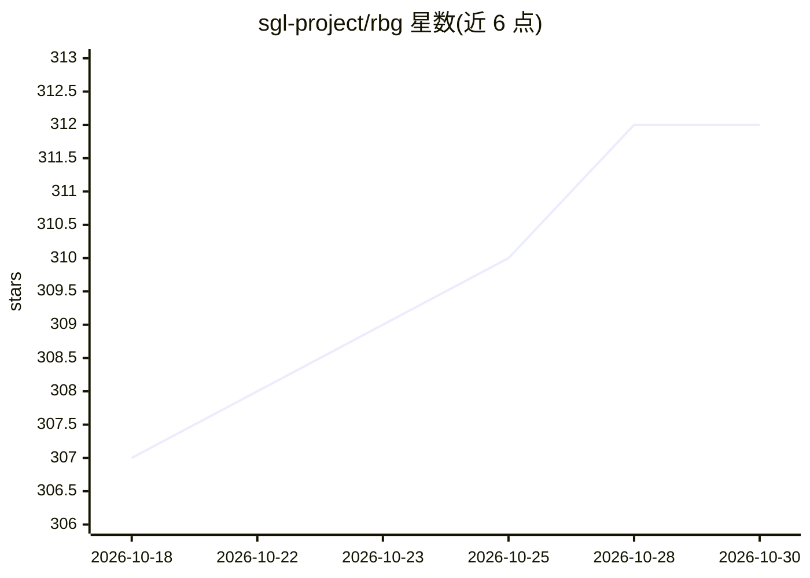

# sgl-project/rbg

⭐ 312 · Go · Apache-2.0 · 推送 2026-10-29 · [GitHub](https://github.com/sgl-project/rbg) · [官网](https://rolebasedgroup.github.io/) · 组织维护 · 中文 README

**Kubernetes 编排框架：以角色组管理分布式 LLM 推理服务**

Kubernetes 自定义 API 与控制器，将 LLM 推理服务建模为角色组（如 gateway→router→prefill→decode），每个角色拥有独立 spec、生命周期与策略，整组作为单一单元部署、升级、扩缩容与故障恢复。提供拓扑感知服务发现、GPU 亲和调度（NVLink→PCIe→RDMA→VPC）、跨角色协调策略与 gang scheduling。附 kubectl-rbg CLI，提供 SGLang 预填充/解码分离等推理示例，集成 NVIDIA Dynamo 与 Mooncake。注意 v1alpha1 及 Deployment/StatefulSet/LeaderWorkerSet 工作负载类型已进入弃用流程。

## 筛选速览

| 维度 | 判定 | 备注 |
|---|---|---|
| AI 角色 | `ai-ecosystem` | LLM/agent 周边工具 |
| 许可风险 | `permissive` | Apache-2.0 |
| 部署形态 | `None` |  |
| 模型依赖 | — | README 未给出锁定关系 |
| 硬件要求 | — | 无带数字的原话,不猜 |
| 安装摩擦 | `low` | 无编译、无系统依赖或容器化 |
| 成熟度 | — | 结构信号不足 |

## 能力要点

- 将推理服务建模为角色组，跨角色原子化部署/升级/扩缩容/故障恢复
- 硬件亲和调度：GPU-NVLink→PCIe→RDMA→VPC 分层选择
- CoordinatedPolicy CRD 控制跨角色滚动更新的 maxSkew 与推进
- 提供 SGLang PD 分离/聚合推理示例与 Mooncake KV cache 复用示例

## 适用场景

- 在 Kubernetes 上部署 prefill/decode 分离的 LLM 推理服务
- 统一管理多角色拓扑服务的升级与扩缩容
- 配合 Mooncake 做 KV cache 跨节点传输与复用

## 场景标签

`推理引擎` · 领域:训练与推理

## 证据(README 行号)

> L9: > 🎯 A Kubernetes API for orchestrating distributed, stateful AI inference workloads with **multi-role collaboration*
> L32: |Multi-role topologies|gateway → router → prefill → decode|
> L36: **RBG** treats an inference service as a **role-based group** — a topologized, stateful, coordinated multi-role org

## 星数曲线

2026-10-18 307 → 2026-10-30 312（+5）

---
*卡片 v1 · prompt 1.4 · 生成 2026-10-21 · 置信度 high · 依据 README sha `caa4524b56da` · [字段定义](../../DATASET.md)*
