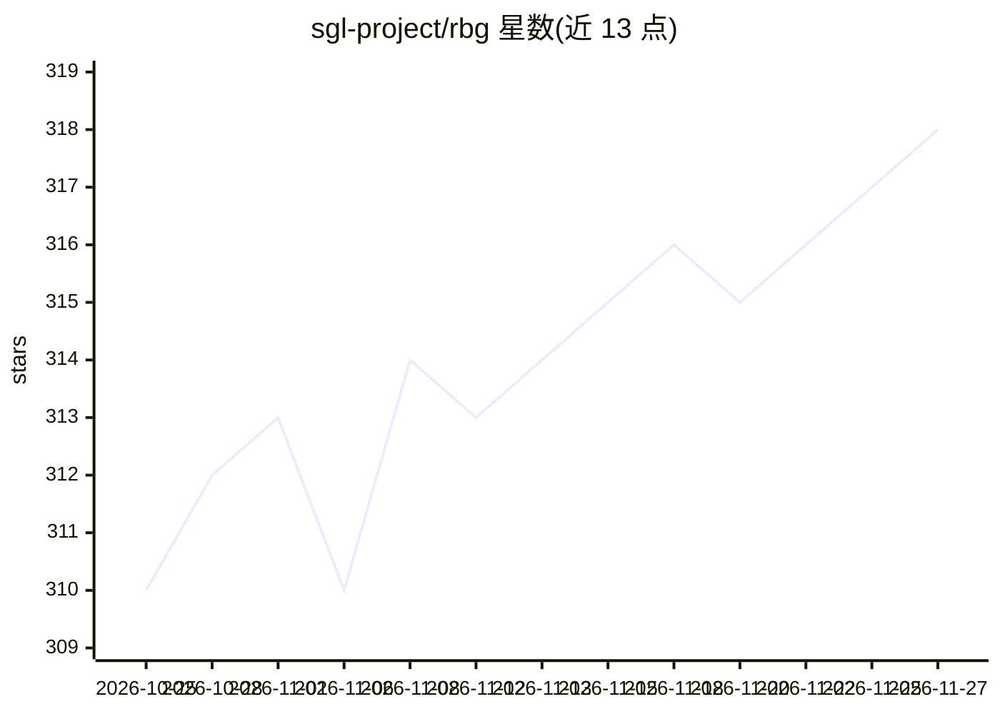

# sgl-project/rbg

⭐ 318 · Go · Apache-2.0 · 推送 2026-11-26 · [GitHub](https://github.com/sgl-project/rbg) · [官网](https://rolebasedgroup.github.io/) · 组织维护 · 中文 README

**面向开发者的 Kubernetes CRD，编排多角色 LLM 推理服务**

RBG（RoleBasedGroup）是 Kubernetes 自定义 API 与控制器，将 LLM 推理服务视为一个多角色、有状态的组（如 gateway→router→prefill→decode）统一管理。核心机制：Role 为调度与发布单元，RoleInstance 支持 Pod 组原地更新，CoordinatedPolicy 跨角色协调滚动更新与扩缩容；调度具有硬件亲和性（GPU-NVLink→PCIe→RDMA→VPC）与拓扑感知服务发现。通过 Helm 安装，附 kubectl-rbg CLI 与 SGLang/Dynamo/Mooncake 的 PD 分离推理示例；v1alpha1 及旧工作负载类型已声明废弃。

## 筛选速览

| 维度 | 判定 | 备注 |
|---|---|---|
| AI 角色 | `ai-ecosystem` | LLM/agent 周边工具 |
| 许可风险 | `permissive` | Apache-2.0 |
| 部署形态 | `None` |  |
| 模型依赖 | local-ok | 支持本地模型 |
| 硬件要求 | — | 无带数字的原话,不猜 |
| 安装摩擦 | `low` | 无编译、无系统依赖或容器化 |
| 成熟度 | — | 结构信号不足 |

## 能力要点

- 以 RoleBasedGroup CRD 将多角色推理服务作为单一逻辑单元管理
- CoordinatedPolicy 控制跨角色滚动更新的 maxSkew 与 progression
- 硬件亲和调度：GPU-NVLink → PCIe → RDMA → VPC
- 提供 kubectl-rbg CLI 与 SGLang PD 分离/聚合推理示例

## 适用场景

- 在 Kubernetes 上部署 SGLang prefill/decode 分离的 LLM 推理服务
- 多节点张量并行推理的 leader-worker 拓扑编排
- 跨角色的原子升级、扩缩容与故障恢复
- 配合 Dynamo/Mooncake 做分布式 KV cache 传输推理

## 场景标签

`推理引擎` · 领域:训练与推理

## 证据(README 行号)

> L10: > 🎯 A Kubernetes API for orchestrating distributed, stateful AI inference workloads with **multi-role collaboration
> L33: |Multi-role topologies|gateway → router → prefill → decode|
> L44: |**RoleBasedGroup**|A group of roles forming one logical service (e.g., one LLM inference deployment).|

## 星数曲线

2026-10-25 310 → 2026-11-27 318（+8）

---
*卡片 v1 · prompt 1.4 · 生成 2026-11-25 · 置信度 high · 依据 README sha `887b5ab3790d` · [字段定义](../../DATASET.md)*
