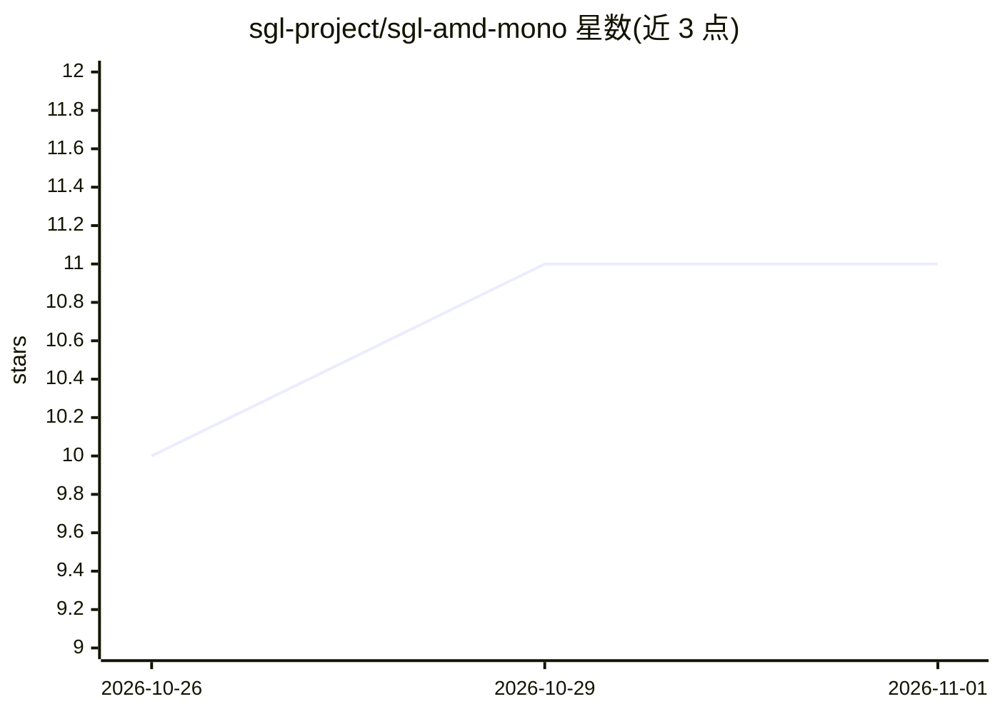

# sgl-project/sgl-amd-mono

⭐ 11 · Python · Apache-2.0 · 推送 2026-10-30 · [GitHub](https://github.com/sgl-project/sgl-amd-mono) · 组织维护

**SGLang 在 AMD Instinct GPU 上的 monokernel 解码内核插件库**

SGLang 框架的 AMD GPU monokernel 插件库：将解码器层的注意力、MoE 与张量并行 all-reduce 合并为每层一至两次 kernel 启动，以减少小批量解码中的启动间隙与集合通信延迟。通过 SGLang 插件入口加载，以 --enable-amd-monokernel 启用；支持 DeepSeek、GLM-5.3、MiniMax-M3、Qwen3.8-Flash-Next 等模型在 MI350X/MI355X（gfx950）上的解码与投机验证步骤。需 ROCm（含 FlyDSL 与 AITER），从源码 pip 安装。README 自声明为实验性功能，内核、模型覆盖与插件接口可能变化。

## 筛选速览

| 维度 | 判定 | 备注 |
|---|---|---|
| AI 角色 | `ai-ecosystem` | LLM/agent 周边工具 |
| 许可风险 | `permissive` | Apache-2.0 |
| 部署形态 | `library` | 以包/库形式分发 |
| 模型依赖 | — | README 未给出锁定关系 |
| 硬件要求 | — | 无带数字的原话,不猜 |
| 安装摩擦 | `medium` | 含编译或系统依赖之一 |
| 成熟度 | `idea` | |

## 能力要点

- 每解码层一至两次 kernel 启动，覆盖注意力、MoE 与两个 all-reduce
- 以 SGLang 通用插件形式加载，注册 monokernel 后端 amd
- 支持 7 个模型在 MI350X/MI355X 上的解码与投机验证步骤（含 TP 1-8）
- graph-safe 路由与 fail-stop 同步：等待失败即停止所有 rank 的启动

## 适用场景

- 在 AMD Instinct GPU 上加速 SGLang 小批量解码
- 为 DeepSeek/GLM/MiniMax/Qwen 模型启用 monokernel 后端服务
- MoRI PD 分离部署中仅在解码侧启用 monokernel

## 场景标签

`推理引擎` · 领域:训练与推理

## 证据(README 行号)

> L5: **SGLang-AMD-Mono** is the monokernel library of the SGLang framework for AMD Instinct GPUs. A monokernel is a persi
> L7: The library implements SGLang's monokernel interface (RFC #43949) and loads as an SGLang general plugin (the `sglang

## 星数曲线

2026-10-26 10 → 2026-11-01 11（+1）

---
*卡片 v1 · prompt 1.4 · 生成 2026-11-01 · 置信度 mid · 依据 README sha `3131b7391a64` · [字段定义](../../DATASET.md)*
