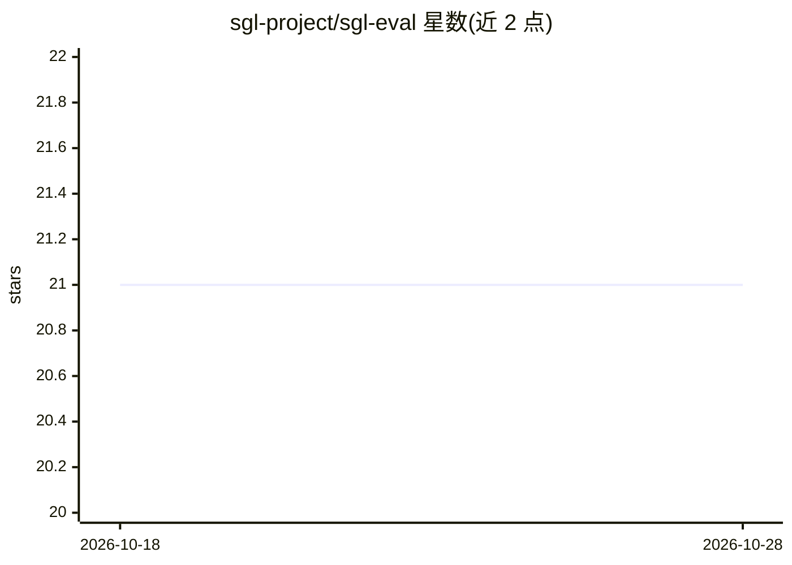

# sgl-project/sgl-eval

⭐ 21 · Python · Apache-2.0 · 推送 2026-10-14 · [GitHub](https://github.com/sgl-project/sgl-eval) · 组织维护

**面向 SGLang 的一键准确率评测客户端，指向任意 OpenAI 兼容端点**

sgl-eval 是一个 Python CLI 评测工具，用于对任意 OpenAI 兼容端点运行基准测试（如 gsm8k、aime25）并输出准确率。评分逻辑（graders、evaluators、prompts、数据集配置）逐字 vendored 自 NeMo-Skills 并固定到特定 commit；本项目仅提供传输层：OpenAI 客户端、线程池 runner、CLI 与装配逻辑。支持部分运行（Ctrl-C 保留已评分样本并标记 partial）、自定义 JSONL 数据集、preset 复现与按 model ID 加载仓库维护的默认参数。目标是成为 SGLang CI 的统一准确率评测客户端，性能基准与训练不在范围内。

## 筛选速览

| 维度 | 判定 | 备注 |
|---|---|---|
| AI 角色 | `ai-ecosystem` | LLM/agent 周边工具 |
| 许可风险 | `permissive` | Apache-2.0 |
| 部署形态 | `library` | 以包/库形式分发 |
| 模型依赖 | — | README 未给出锁定关系 |
| 硬件要求 | — | 无带数字的原话,不猜 |
| 安装摩擦 | `low` | 无编译、无系统依赖或容器化 |
| 成熟度 | — | 结构信号不足 |

## 能力要点

- 一键对任意 OpenAI 兼容端点运行准确率评测（gsm8k、aime25 等）
- 评分逻辑 vendored 自 NeMo-Skills 并固定 commit，可用脚本同步升级并跑上游测试
- 支持部分运行：Ctrl-C 保留已评分样本，metrics.json 标记 partial
- preset 机制保存/复现 benchmark、端点、采样配置组合

## 适用场景

- 为自部署的 SGLang 端点快速验证模型准确率
- 用自己的 JSONL 题目集对端点跑一次评分
- 在 CI 中替代分散的评测脚本做统一准确率回归

## 场景标签

 · 领域:LLM 基础设施/评测

## 证据(README 行号)

> L6: One-click accuracy evaluation harness for SGLang.
> L92: **Anything that decides a score is vendored verbatim from NeMo-Skills.**
> L119: The goal is to be the single accuracy-eval client SGLang's CI calls, in place

## 星数曲线

2026-10-18 21 → 2026-10-28 21（+0）

---
*卡片 v1 · prompt 1.4 · 生成 2026-10-28 · 置信度 high · 依据 README sha `37af08a19fe8` · [字段定义](../../DATASET.md)*
