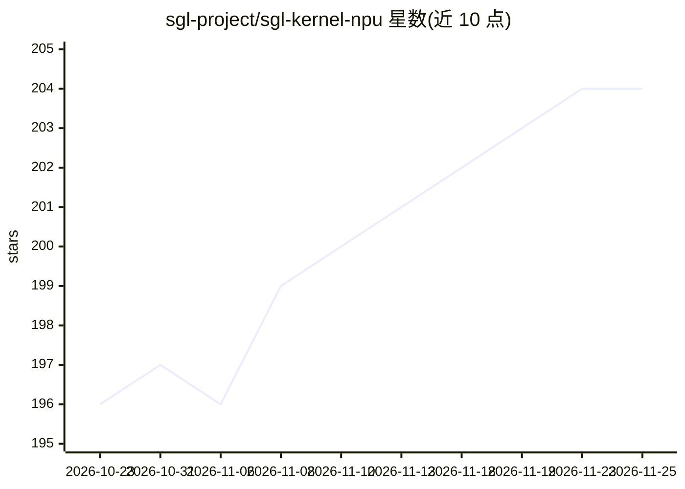

# sgl-project/sgl-kernel-npu

⭐ 204 · C++ · MIT · 推送 2026-11-23 · [GitHub](https://github.com/sgl-project/sgl-kernel-npu) · 组织维护

**为 Ascend NPU 提供 SGLang LLM 推理算子库**

SGLang 框架在华为 Ascend NPU 上的官方算子库，面向 LLM 推理，由两部分组成：DeepEP-Ascend 提供 MoE 模型专家并行的 all-to-all 通信算子（Normal 与 Low-Latency 两种模式）；SGLang-Kernel-NPU 提供注意力（MLA/GQA）、Flash Linear Attention、归一化、激活函数、LoRA 适配器、投机解码树构建、KV Cache 管理等推理算子。README 给出从源码构建的两种入口，并列出 A3 SuperPOD 上的带宽与延迟测试数据。

## 筛选速览

| 维度 | 判定 | 备注 |
|---|---|---|
| AI 角色 | `ai-ecosystem` | LLM/agent 周边工具 |
| 许可风险 | `permissive` | MIT |
| 部署形态 | `None` |  |
| 模型依赖 | — | README 未给出锁定关系 |
| 硬件要求 | — | 无带数字的原话,不猜 |
| 安装摩擦 | `low` | 无编译、无系统依赖或容器化 |
| 成熟度 | — | 结构信号不足 |

## 能力要点

- DeepEP-Ascend 专家并行通信算子，支持 Normal 与 Low-Latency 模式
- MLA/GQA 注意力、RMSNorm、SwiGLU、LoRA、KV Cache 管理等推理算子集
- INT8/FP8/BF16 量化以降低显存带宽
- 提供 build.sh 与 setup.py 两种源码构建入口

## 适用场景

- 在 Ascend NPU 上运行 SGLang 的 LLM 推理
- 为 MoE 模型配置专家并行通信算子
- 为 SGLang 适配新的昇腾推理算子

## 场景标签

`推理引擎` · 领域:训练与推理

## 证据(README 行号)

> L5: **SGLang-Kernel-NPU** is the official kernel library of the SGLang framework for Ascend NPU. It delivers high-perfor
> L9: The library consists of two main components:
> L10: - **DeepEP-Ascend**: Ascend implementation of DeepEP, providing highly optimized Expert Parallelism (EP) communicat
> L11: - **SGLang-Kernel-NPU**: A comprehensive collection of optimized inference kernels including attention mechanisms, 

## 星数曲线

2026-10-23 196 → 2026-11-25 204（+8）

---
*卡片 v1 · prompt 1.4 · 生成 2026-11-25 · 置信度 high · 依据 README sha `2b2f29ec758c` · [字段定义](../../DATASET.md)*
