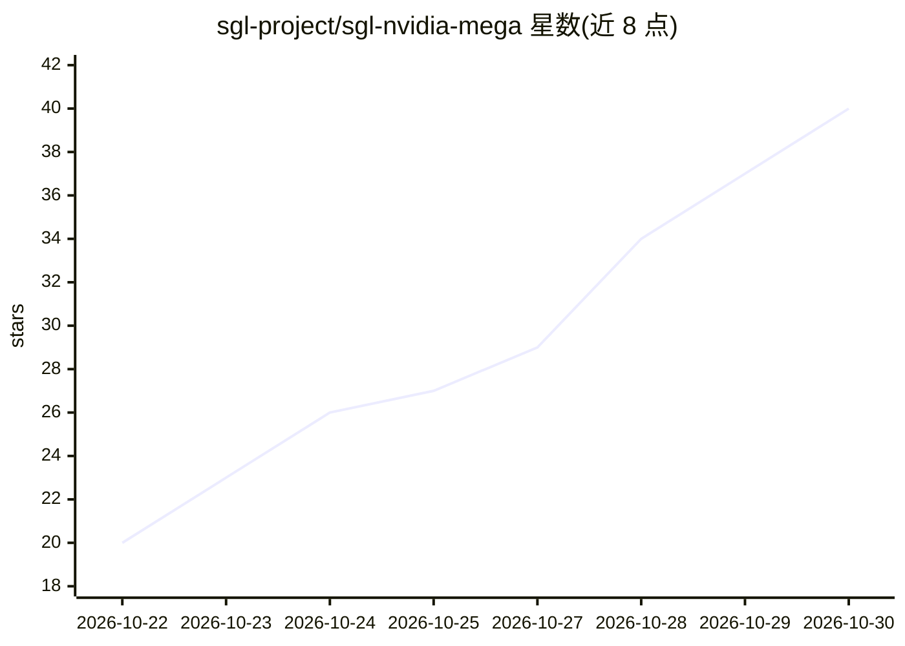

# sgl-project/sgl-nvidia-mega

⭐ 40 · Python · Apache-2.0 · 推送 2026-10-28 · [GitHub](https://github.com/sgl-project/sgl-nvidia-mega) · 组织维护

**SGLang 的 NVIDIA megakernel 插件：加速小批量 decode 步**

作为 SGLang 框架的通用插件加载（sglang.srt.plugins 入口），通过 --enable-nvidia-megakernel 标志启用，为覆盖的模型（DeepSeek-V4.1-Flash、Kimi K3）将小批量 decode 步替换为 megakernel：各算子通过 mailbox 与 programmatic dependent launch 传递输出，替代逐算子边界。在模型加载时完成缓冲区与内核编译，CUDA graph 安全，fail-stop 同步且无静默回退。要求 SGLang CUDA 13 镜像、多卡 GB300 配置；声明为实验性，覆盖范围与开关可能变更。源码 clone 后 pip install -e 安装。

## 筛选速览

| 维度 | 判定 | 备注 |
|---|---|---|
| AI 角色 | `ai-ecosystem` | LLM/agent 周边工具 |
| 许可风险 | `permissive` | Apache-2.0 |
| 部署形态 | `library` | 以包/库形式分发 |
| 模型依赖 | — | README 未给出锁定关系 |
| 硬件要求 | — | 无带数字的原话,不猜 |
| 安装摩擦 | `medium` | 含编译或系统依赖之一 |
| 成熟度 | `idea` | |

## 能力要点

- 以 SGLang 插件形式加载，--enable-nvidia-megakernel 启用，关闭时 SGLang 运行不受影响
- 覆盖 DeepSeek-V4.1-Flash（4×GB300）与 Kimi K3（8×GB300）的小批量 decode 步
- 加载时构建，步骤内无编译/分配；fail-stop 同步与无静默回退设计
- 不支持配置在启动时即报错并列出原因

## 适用场景

- 在 GB300 集群上运行 DeepSeek-V4.1-Flash 或 Kimi K3 推理服务
- 替换 SGLang 标准 decode 路径以运行 megakernel 实现
- 用 SGLANG_NVIDIA_MEGAKERNEL_SLOTS 覆盖槽位做测试与二分排查

## 场景标签

`推理引擎` · 领域:训练与推理

## 证据(README 行号)

> L7: The package loads as an SGLang general plugin (the `sglang.srt.plugins` entry point) and is turned on with SGLang's 
> L5: **SGLang-NVIDIA-Mega** holds the NVIDIA megakernels of the SGLang framework: for each model it covers, the code of i

## 星数曲线

2026-10-22 20 → 2026-10-30 40（+20）

---
*卡片 v1 · prompt 1.4 · 生成 2026-10-26 · 置信度 mid · 依据 README sha `d49af142dee2` · [字段定义](../../DATASET.md)*
