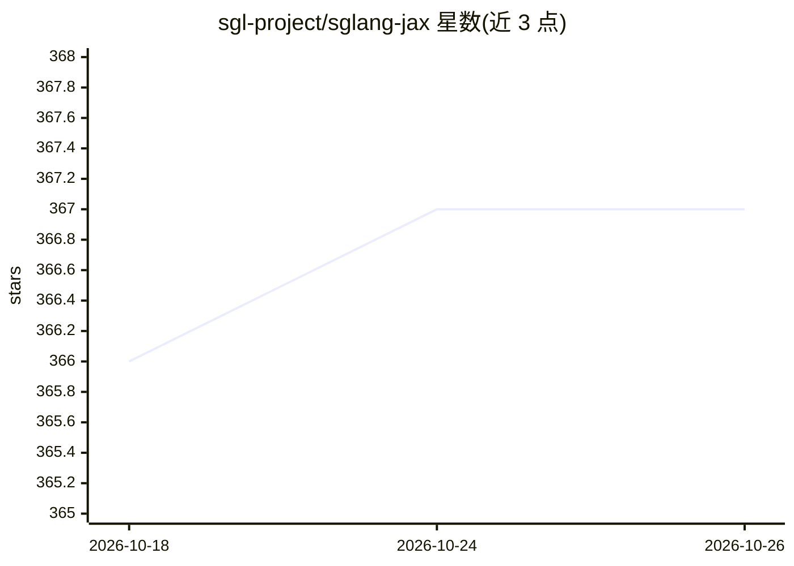

# sgl-project/sglang-jax

⭐ 367 · Python · Apache-2.0 · 推送 2026-10-22 · [GitHub](https://github.com/sgl-project/sglang-jax) · 组织维护

**面向 TPU 的 JAX 大模型推理引擎，SGL 的 JAX 后端**

sgl-project 维护的 LLM 推理引擎，基于 JAX 并针对 Google TPU 优化，是 SGLang 的 JAX 后端。提供 OpenAI 兼容 API，内置连续批处理调度器、Radix Tree KV 缓存前缀共享、FlashAttention 内核与张量并行多 TPU 切分；对 Qwen 系列（含 MoE）提供一级支持，并支持 DeepSeek V2/V3、Gemma 2、GLM-4 MoE 等模型及 Wan T2V、Qwen2.5-VL 等多模态模型。提供 pip 安装与测试套件，文档含 cookbook 与基准脚本。

## 筛选速览

| 维度 | 判定 | 备注 |
|---|---|---|
| AI 角色 | `ai-ecosystem` | LLM/agent 周边工具 |
| 许可风险 | `permissive` | Apache-2.0 |
| 部署形态 | `library` | 以包/库形式分发 |
| 模型依赖 | — | README 未给出锁定关系 |
| 硬件要求 | — | 无带数字的原话,不猜 |
| 安装摩擦 | `low` | 无编译、无系统依赖或容器化 |
| 成熟度 | — | 结构信号不足 |

## 能力要点

- 面向 TPU 的 JAX 推理引擎，支持张量并行多设备切分
- Radix Tree KV 缓存实现请求间前缀共享
- OpenAI 兼容 API，可接入 LangChain / LlamaIndex 等现有客户端
- 支持 Qwen / DeepSeek / GLM-4 / Grok-2 等模型及 Wan T2V、Qwen2.5-VL 多模态模型

## 适用场景

- 在 TPU 集群上部署大规模 LLM 服务
- 通过 OpenAI 兼容接口替换现有推理后端
- 运行 Qwen MoE 等模型的批量推理与基准测试

## 场景标签

`推理引擎` · 领域:训练与推理

## 证据(README 行号)

> L1: # SGL-JAX: High-Performance LLM Inference on JAX/TPU
> L15: - **OpenAI-Compatible API**: Provides a drop-in replacement for the OpenAI API, allowing for seamless integration w
> L24: 1. **HTTP Server**: The entry point for all requests, compatible with the OpenAI API standard.

## 星数曲线

2026-10-18 366 → 2026-10-26 367（+1）

---
*卡片 v1 · prompt 1.4 · 生成 2026-10-21 · 置信度 high · 依据 README sha `bf234a643d6a` · [字段定义](../../DATASET.md)*
