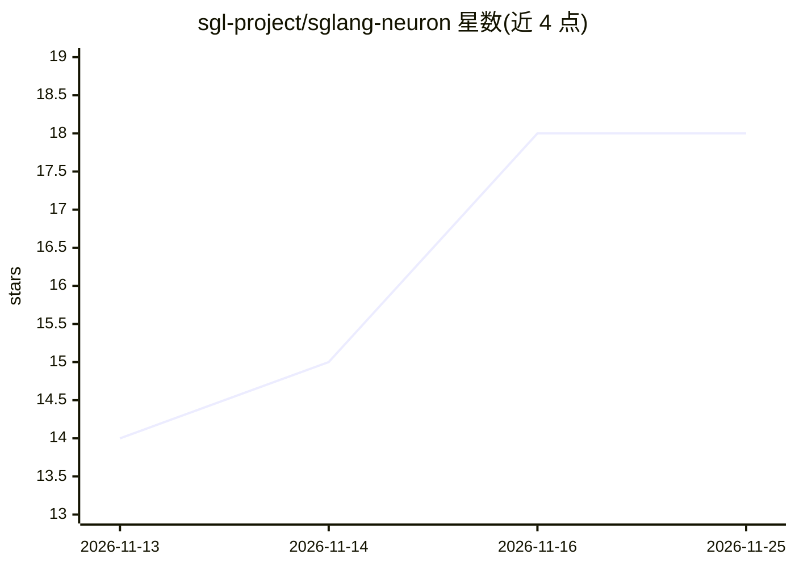

# sgl-project/sglang-neuron

⭐ 18 · Apache-2.0 · 推送 2026-11-12 · [GitHub](https://github.com/sgl-project/sglang-neuron) · 组织维护

**在 AWS Trainium NeuronCores 上运行 SGLang 的平台插件**

SGLang 的平台插件，使 SGLang 的启动器、调度器与 API 可在 AWS Trainium NeuronCores 上服务 LLM 与扩散模型；提供设备抽象、attention 后端、KV 池与分配器、graph runner 和模型实现，运行于 TorchNeuron，并锁定上游 SGLang 特定 commit。支持聚合与预填充/解码分离部署（KV cache 经 NIXL/EFA 迁移）、多种并行策略、投机解码与多种前缀缓存后端。当前为 public preview，LLM 需 Trn3 实例、扩散模型需 trn2.48xlarge，依赖 Neuron SDK 与 Neuron 驱动，通过容器镜像或源码脚本安装。

## 筛选速览

| 维度 | 判定 | 备注 |
|---|---|---|
| AI 角色 | `ai-ecosystem` | LLM/agent 周边工具 |
| 许可风险 | `permissive` | Apache-2.0 |
| 部署形态 | `self-host` | docker 或自建部署 |
| 模型依赖 | — | README 未给出锁定关系 |
| 硬件要求 | — | 无带数字的原话,不猜 |
| 安装摩擦 | `low` | 无编译、无系统依赖或容器化 |
| 成熟度 | `idea` | |

## 能力要点

- 在 NeuronCores 上提供 SGLang 的设备、attention 后端、KV 池与 graph runner，SGLang 本体不修改
- 聚合与分离式服务（预填充/解码分离，KV cache 经 NIXL 和 EFA 迁移）
- 启动时编译全部 prefill/decode shape，服务期间不再编译
- 支持 TP/EP/DP/PP/CP 并行与 MTP、DSPARK 投机解码，多种前缀缓存后端

## 适用场景

- 在 Trainium 实例上用 SGLang 服务 Qwen、GLM、Kimi 等 LLM
- 跨节点分离预填充与解码以服务大参数模型
- 在 trn2.48xlarge 上运行 FLUX、Wan 等文生图/文生视频扩散模型

## 场景标签

`推理引擎` · 领域:训练与推理

## 证据(README 行号)

> L3: sglang-neuron is an SGLang platform plugin for AWS Trainium. It serves large language models (LLMs) and diffusion
> L4: models on NeuronCores through SGLang's own launcher, scheduler and APIs. SGLang itself stays unmodified: it finds th

## 星数曲线

2026-11-13 14 → 2026-11-25 18（+4）

---
*卡片 v1 · prompt 1.4 · 生成 2026-11-18 · 置信度 mid · 依据 README sha `e534b85f61f8` · [字段定义](../../DATASET.md)*
