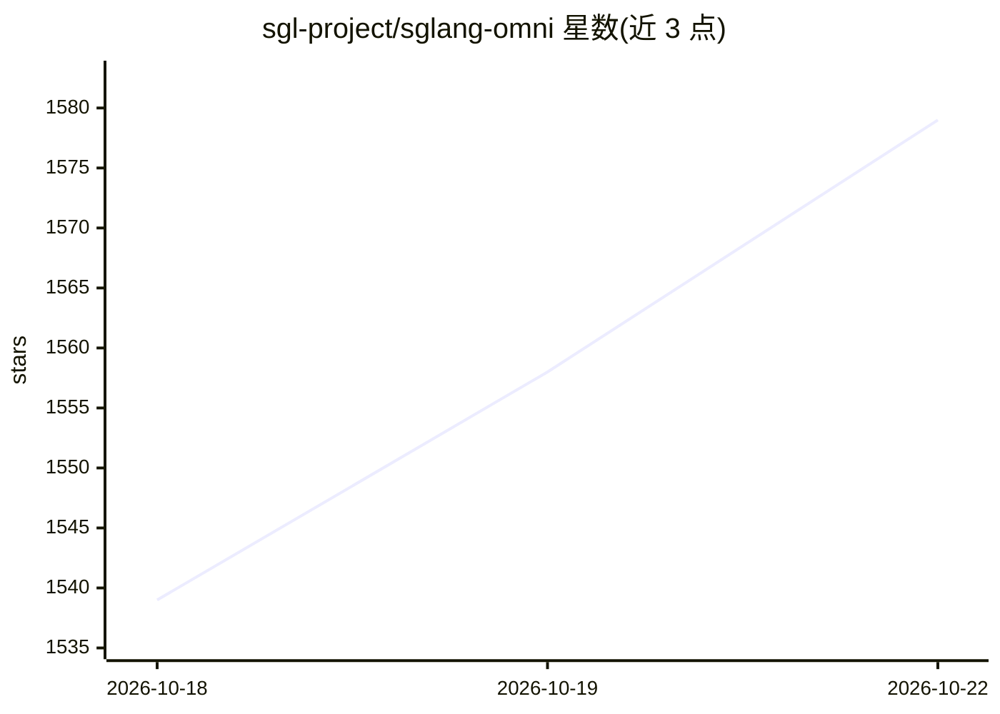

# sgl-project/sglang-omni

⭐ 1,579 · Python · Apache-2.0 · 推送 2026-10-21 · [GitHub](https://github.com/sgl-project/sglang-omni) · [官网](https://sgl-project.github.io/sglang-omni/) · 组织维护

**语音与全模态模型的推理服务运行时框架**

面向 omni、语音与 TTS 模型的多阶段推理服务运行时：将生成过程拆分为预处理、编码器、自回归引擎、解码器、声码器等阶段，各阶段由匹配负载的调度器运行，控制面协调请求、中继数据面经共享内存/NCCL/NIXL/Mooncake 传输张量。对外提供 OpenAI 兼容端点（多模态聊天、语音生成、批量/流式语音、转写），并组合 SGLang 执行自回归调度。服务模型覆盖 Qwen3-Omni/TTS/ASR、MOSS-TTS、Higgs Audio v3、MiniMax Music 3 等，另含多 worker 路由器。后端支持 NVIDIA CUDA（默认）、Apple Silicon（实验）、Intel XPU（实验）。

## 筛选速览

| 维度 | 判定 | 备注 |
|---|---|---|
| AI 角色 | `ai-ecosystem` | LLM/agent 周边工具 |
| 许可风险 | `permissive` | Apache-2.0 |
| 部署形态 | `library` | 以包/库形式分发 |
| 模型依赖 | — | README 未给出锁定关系 |
| 硬件要求 | — | 无带数字的原话,不猜 |
| 安装摩擦 | `medium` | 含编译或系统依赖之一 |
| 成熟度 | `idea` | |

## 能力要点

- 多阶段解码运行时：阶段化调度与传输感知执行
- OpenAI 兼容端点：语音生成、批量/流式、上传音色、转写
- 多 worker OpenAI 兼容 Router（健康、能力发现）
- 支持 NVIDIA CUDA / Apple Silicon / Intel XPU 三类后端

## 适用场景

- 部署 TTS/ASR/全模态模型并对外提供 OpenAI 兼容 API
- 本地运行 Qwen3-ASR 等语音识别与转写（含说话人分离）
- 多卡/多 worker 场景下做语音模型生产部署

## 场景标签

`推理引擎` · 领域:训练与推理

## 证据(README 行号)

> L32: SGLang-Omni is a multi-stage serving runtime for omni, speech, and TTS models. Its design target is multi-stage dec
> L37: - **API surface**: OpenAI-compatible endpoints expose multimodal chat, speech generation, batch speech, streaming s

## 星数曲线

2026-10-18 1,539 → 2026-10-22 1,579（+40）

---
*卡片 v1 · prompt 1.4 · 生成 2026-10-21 · 置信度 high · 依据 README sha `673212fefd99` · [字段定义](../../DATASET.md)*
